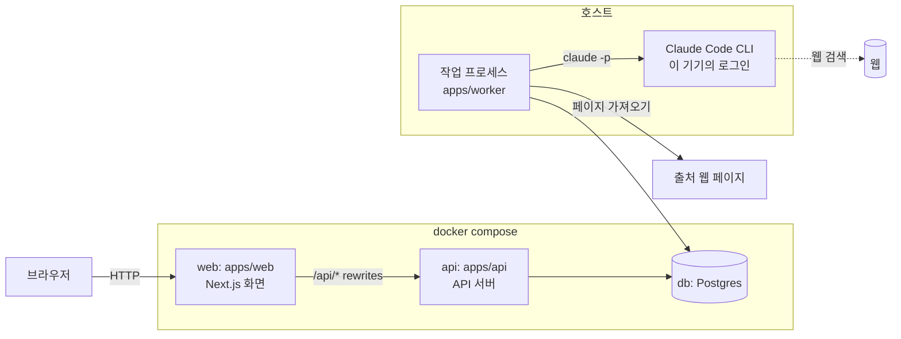
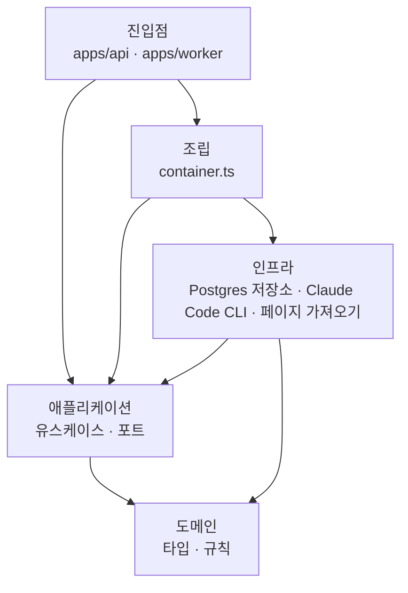
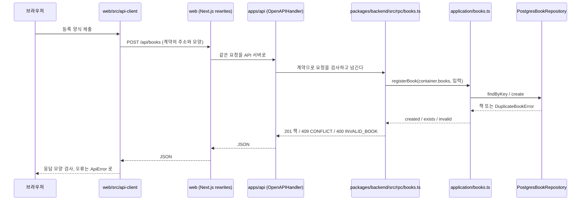
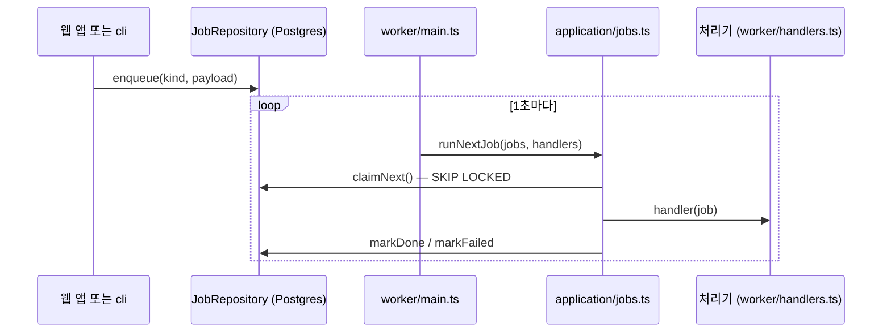
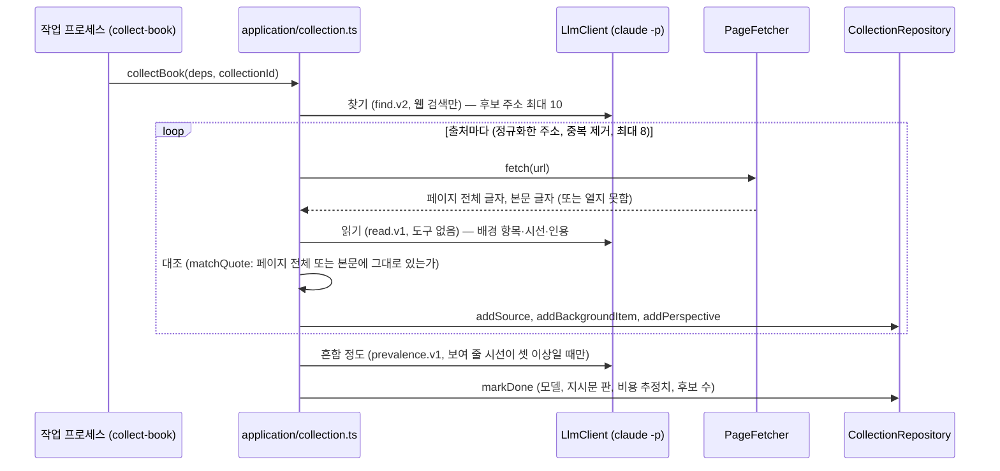
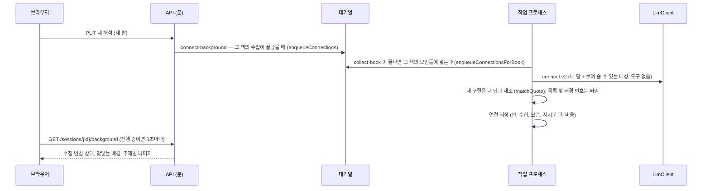
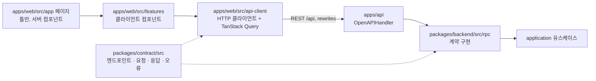

# inkle 아키텍처

> 시스템이 어떻게 생겼는지 한곳에서 본다. 각 결정의 이유와 대안은 ADR 에 있다 (`docs/decisions/README.md`).
> **현재**는 코드에 있는 것, **예정**은 ADR 로 정했지만 아직 만들지 않은 것이다.
> 마지막 갱신: 2026-11-20 (spec-01-09, 배경과 연결).

## 1. 한눈에



| 실행 단위 | 앱 | 어디서 | 시작 명령 (루트) | 하는 일 | 근거 |
|---|---|---|---|---|---|
| web | `apps/web` | compose, `127.0.0.1:3000` | `pnpm dev` | 화면. `/api/*` 는 API 서버로 넘긴다 (`apps/web/next.config.ts` 의 rewrites, `API_ORIGIN`) | ADR-007, ADR-009 |
| api | `apps/api` | compose, `127.0.0.1:4000` | `pnpm db:migrate && pnpm api` | HTTP API (계약의 주소, `/api/openapi.json`). 뜰 때 마이그레이션 적용 | ADR-009 |
| db | - | compose, `127.0.0.1:54329` | - | 모든 자료와 작업 대기열 | ADR-001 |
| 작업 프로세스 | `apps/worker` | 호스트 | `pnpm worker` | 대기열의 작업을 처리 (자료 수집 `collect-book`, 연결 만들기 `connect-background`, 시험용 `noop`). 조립은 `container.workerDeps` | ADR-001, ADR-004 |
| Claude Code CLI | - | 호스트 | - | LLM 호출. 구독 로그인, API 키 없음. 빈 임시 디렉토리에서 MCP 서버와 사용자 설정 없이 실행 | ADR-004 |

- 컨테이너는 개발용 이미지 하나(`Dockerfile`)에서 시작 명령만 다르다 (ADR-010).
- 작업 프로세스가 호스트에서 뜨는 이유: CLI 를 이 기기의 로그인으로 쓰기 때문이다 (ADR-004 §가정의 확인 결과).
- 브라우저는 같은 주소의 `/api` 만 안다. API 가 다른 서버라는 사실은 Next.js 의 rewrites 한 곳에만 있다.

## 2. 구조: pnpm 워크스페이스

ADR-010. 앱 셋과 패키지 둘이다. 영역 경계는 패키지 의존성이 지킨다 (`package.json` 에 없는 것은 가져올 수 없다).

```
inkle/
├─ apps/
│  ├─ web/                @inkle/web — Next.js 화면
│  │  ├─ src/app/         라우트 (자료를 읽지 않는 틀), globals.css (테마 토큰)
│  │  ├─ src/features/    기능별 화면 (books, sessions, background, writing, system)
│  │  ├─ src/ui/          shadcn/ui 공통 부품
│  │  ├─ src/api-client/  HTTP 클라이언트 (화면이 서버를 부르는 유일한 통로)
│  │  ├─ src/providers.tsx, src/product.ts
│  │  ├─ src/testing/     MSW, 브라우저 렌더링 도우미
│  │  └─ next.config.ts, components.json
│  ├─ api/                @inkle/api — API 서버 진입점 (src/main.ts), 명령 (src/cli/)
│  └─ worker/             @inkle/worker — 작업 프로세스 진입점 (src/main.ts)
├─ packages/
│  ├─ contract/           @inkle/contract — HTTP 계약 (엔드포인트 · 요청 · 응답 · 오류)
│  └─ backend/            @inkle/backend
│     └─ src/domain/ application/ infrastructure/ rpc/ server/ worker/ testing/ container.ts
├─ e2e/                   Playwright (web + api + db)
├─ tests/                 저장소 수준 테스트 (패키지 의존성 규칙)
├─ scripts/spike/         일회성 확인 스크립트
├─ docker/, Dockerfile, compose.yaml
└─ package.json (루트, 공통 명령), pnpm-workspace.yaml, tsconfig.base.json,
   vitest.config.mts, eslint.config.mjs, playwright.config.ts
```

| 패키지 | 의존할 수 있는 것 | 의존할 수 없는 것 | 확인 |
|---|---|---|---|
| `@inkle/web` | `@inkle/contract`, React, Next.js, 화면 라이브러리 | `@inkle/backend`, `postgres` | `tests/workspace.test.ts`, 타입 검사, lint |
| `@inkle/api`, `@inkle/worker` | `@inkle/backend` | `@inkle/web`, React, Next.js | `tests/workspace.test.ts` |
| `@inkle/backend` | `@inkle/contract`, DB, oRPC 서버 | 앱, React, Next.js | `tests/workspace.test.ts` |
| `@inkle/contract` | `zod`, `@orpc/contract` 만 | 그 밖의 모든 것 | `tests/workspace.test.ts`, lint |

- 패키지는 빌드 없이 TypeScript 소스를 내보낸다. 패키지 안의 가져오기는 상대 경로이고, `@/` 별칭은 `apps/web` 안에서만 쓴다.
- `@inkle/backend` 가 내보내는 것: `./container`, `./server`, `./worker`, `./db`, `./migrate`, `./application/*`, `./testing/*`.
- 패키지 안쪽 규칙은 루트 `eslint.config.mjs` 가 지킨다: backend 의 계층(ADR-006), 화면의 HTTP 호출과 UI 일관성(ADR-007). 확인은 `packages/backend/src/architecture.test.ts`, `apps/web/src/architecture.test.ts`.

### 워크스페이스에서 함께 쓰는 것

| 무엇 | 어디 | 비고 |
|---|---|---|
| TypeScript 설정 | `tsconfig.base.json` 을 각 패키지가 확장 | `pnpm typecheck` 는 각 패키지와 루트 파일을 검사 |
| 테스트 | 루트 `vitest.config.mts` 의 프로젝트 넷 (backend, web, web-browser, workspace) | `pnpm test` 한 번으로 전부 |
| lint | 루트 `eslint.config.mjs` | `eslint-config-next` 때문에 루트에 `next` 를 개발 의존성으로 둔다 |
| 이미지 | `Dockerfile` 하나 | 워크스페이스마다 `node_modules` 를 compose 의 이름 없는 볼륨으로 둔다 |

## 2-0. 모노레포로 옮긴 기록

- **결정** (2026-11-17): 서버가 둘이면 앱이 둘이다. 코드가 적은 지금 옮긴다 (사용자 결정).
- **완료** (2026-11-18, spec-01-05): 아래 대응표대로 옮겼다. 동작은 바뀌지 않았다. 이전 배치는 ADR-008 (대체됨).

| 이전 (`src/…`) | 지금 |
|---|---|
| app/, frontend/{features,ui,api-client,testing}, frontend/providers.tsx, shared/product.ts | `apps/web/src/` |
| shared/contract/ | `packages/contract/src/` |
| backend/{domain,application,infrastructure,rpc,testing}, backend/container.ts | `packages/backend/src/` |
| backend/server/http-server.ts | `packages/backend/src/server/` |
| backend/server/main.ts, backend/cli/ | `apps/api/src/` |
| backend/worker/handlers.ts | `packages/backend/src/worker/` |
| backend/worker/main.ts | `apps/worker/src/` |
| architecture.test.ts | 계층 규칙은 `packages/backend`, 화면 규칙은 `apps/web`, 영역 경계는 `tests/workspace.test.ts` |

### 앞으로 남은 것 (배포 방식을 정할 때)

- 앱별 운영 이미지. 화면을 정적으로 내보낼지(`docs/goals.md` §열린 질문).
- 정적 내보내기를 고르면: 동적 주소(`/books/{bookId}`)를 클라이언트 라우팅으로 바꾸고, Next.js rewrites 대신 배포 환경의 경로 전달이나 CORS 를 쓴다. HTTP 클라이언트의 기본 주소는 `apps/web/src/api-client/` 의 `origin` 옵션.
- 이를 쉽게 하려고 지금 지키는 것: 페이지에서 서버 자료를 읽지 않는다(요청 시점의 API 금지), Server Actions 를 쓰지 않는다, API 주소는 HTTP 클라이언트 한 곳에서만 정하고 API 가 다른 서버라는 사실은 rewrites 한 곳에만 둔다.

## 2-1. 서버 계층

ADR-006. 의존은 바깥에서 안쪽으로만 간다.



| 계층 | 폴더 | 담는 것 | 금지 |
|---|---|---|---|
| 도메인 | `packages/backend/src/domain/` | 타입, 상수, 순수한 규칙 | DB, 프레임워크, 다른 계층 |
| 애플리케이션 | `packages/backend/src/application/` | 유스케이스 함수, 포트(`ports.ts`) | DB, 프레임워크, 인프라, 조립, 진입점 |
| 인프라 | `packages/backend/src/infrastructure/` | 포트 구현, DB 연결과 마이그레이션 | 조립, 진입점 |
| 조립 | `packages/backend/src/container.ts` | 실제 구현을 만들어 묶는다 | - |
| 진입점 | `packages/backend/src/rpc/`·`server/` (API), `apps/api/src/`, `apps/worker/src/` | 입력을 받아 유스케이스를 부른다 | SQL 직접 실행 |

금지 항목은 lint 가 막는다 (`eslint.config.mjs`).

### 포트

| 포트 | 하는 일 | 구현 | 상태 |
|---|---|---|---|
| `HealthProbe` | DB 에 닿는지 | `PostgresHealthProbe` | 현재 |
| `UserRepository` | 사용자 찾기 | `PostgresUserRepository` | 현재 |
| `JobRepository` | 작업 넣기, 가져가기, 끝내기, 실패 기록 | `PostgresJobRepository` | 현재 |
| `BookRepository` | 책 만들기, 찾기(번호, 정규화한 키), 목록 | `PostgresBookRepository` | 현재 |
| `SessionRepository` | 모임 만들기, 사용자 것만 찾기, 책별 목록 | `PostgresSessionRepository` | 현재 |
| `InterpretationRepository` | 내 해석의 판 덧붙이기, 최근 판, 모든 판 | `PostgresInterpretationRepository` | 현재 |
| `CollectionRepository` | 수집과 출처·배경 항목·시선·인용 저장, 책의 최근 수집 | `PostgresCollectionRepository` | 현재 (spec-01-08) |
| `LlmClient` | 지시문과 결과 형식(JSON Schema), 쓸 도구를 주고 결과·비용·모델을 받는다 | `ClaudeCodeCli` (이후 Claude API) | 현재 (spec-01-08) |
| `PageFetcher` | 주소를 열어 페이지 전체 글자와 본문 글자를 받는다 | `HttpPageFetcher` (내부 주소 차단, 리디렉션 매번 검사, 문자 인코딩 감지, Readability) | 현재 (spec-01-08) |
| `ConnectionRepository` | 연결 만들기(모임·판·수집)와 연결 저장, 판의 최근 연결 만들기 | `PostgresConnectionRepository` | 현재 (spec-01-09) |
| 비교 … 저장소 | ADR-002 의 독자 단위 자료 | Postgres | 예정 (spec-01-11 ~) |

## 3. 흐름

### HTTP 요청 (현재: 상태 확인, 책)



화면은 HTTP API 로만 자료를 읽고 쓴다 (ADR-001 §4).

### 먼저 쓰고, 그다음 본다 (현재: 문)

phase-01 성공 기준 5. 모임의 단계는 저장된 내 해석이 있는지로 정해진다 (`writing` → `interpretation_saved`).

- 문(門)은 애플리케이션 층의 `requireUnlocked` 하나다 (`packages/backend/src/application/sessions.ts`). 내 해석 전이면 `locked`, 다른 사용자의 모임이면 `not_found`.
- 배경·다른 시선·비교를 읽는 API 는 모두 이 함수를 거친다. 지금은 배경(`GET /api/sessions/{id}/background`, `POST …/background/recollect`, spec-01-09). 잠긴 모임에는 수집 상태도 내주지 않는다 (`403 LOCKED`).
- 모임 조회(`GET /api/sessions/{id}`)는 단계와 무관하게 책, 질문 묶음, 최근 내 해석만 담는다. 다음 단계의 자료는 담지 않는다.

### 작업 (현재: 자료 수집, 시험용 작업)



등록되지 않은 종류의 작업과 처리기의 예외는 `failed` 와 이유로 남는다.

### 자료 수집 (현재: spec-01-08)

ADR-004 §2. 모임을 시작하면(`startSession`) 그 책의 수집을 대기열에 넣는다 (`enqueueCollection`). 책에 끝난 수집이나 진행 중인 수집이 있으면 넣지 않는다. 대기·진행 중으로 2시간 넘게 멈춘 수집은 막지 않는다 (`blocksNewCollection`).



- 단계마다 한 번 묻고, 형식 오류나 실패면 한 번 더 묻는다. 지시문은 `packages/backend/src/application/prompts/*.v{N}.ts` (판, zod 결과 형식, `render()`).
- 대조는 공백을 모두 지우고 따옴표·말줄임표를 통일한 뒤 문자열로 찾는다 (`domain/quote-match.ts`). 10자 미만 인용은 통과하지 않는다.
- 대조를 통과한 인용이 하나도 없는 항목은 저장하되 내주지 않는다 (`isShowable`). 결과는 내 해석이 저장된 모임에만 내준다 (ADR-004 §7, spec-01-09).
- 확인 명령: `pnpm collect <bookId> [--force]`, `pnpm collect:report <bookId> [--quotes]`.

### 배경과 연결 (현재: spec-01-09)

ADR-002 의 연결: 배경 항목 하나가 내 해석의 어느 부분과 맞닿는지. 독자 단위이고 내 해석의 **판 하나**에 대해 만든다.



- 연결의 근거는 내 답에서 그대로 옮긴 구절이고, 출처 인용과 같은 규칙으로 대조한다 (`domain/connection.ts` 의 `checkConnections`). 통과하지 못한 연결은 저장하되 내주지 않는다.
- 같은 판·같은 수집으로는 한 번만 만든다. 새 판을 저장하면 새로 만들고, 이전 판의 연결은 남는다 (ADR-005).
- 오래 멈춘 수집·연결 만들기는 `failed` 로 내준다. 수집이 실패했거나 없으면 화면의 "다시 모으기"가 `recollect` 를 부른다.
- 화면은 `/sessions/{id}/background` (`apps/web/src/features/background/`). 글쓴이 표시는 `apps/web/src/ui/authored.tsx`.

## 4. 데이터

ADR-002. 자료는 두 층이다.

| 층 | 자료 | 사용자 식별자 | 상태 |
|---|---|:---:|---|
| 책 단위 | 책 | 없음 | 현재 (spec-01-04) |
| 책 단위 | 수집, 출처(페이지 전체 글자 보관), 배경 항목, 시선, 인용 | 없음 | 현재 (spec-01-08) |
| 독자 단위 | 모임, 내 해석(판) | 있음 (ADR-003) | 현재 (spec-01-07) |
| 독자 단위 | 연결 만들기, 연결 (모임을 거쳐 사용자) | 있음 (ADR-003) | 현재 (spec-01-09) |
| 독자 단위 | 비교, 끝의 한 번 고르기, 토론, 노트 | 있음 (ADR-003) | 예정 |
| 운영 | 사용자, 작업 대기열, 적용한 마이그레이션 | - | 현재 |

- 모든 글에 글쓴이(나 / AI / 외부 사람)를 따로 저장한다 (ADR-002 §3).
- 원본은 덧붙이기만 하고, 파생물은 만든 재료와 지시문의 판을 남긴다 (ADR-005).
- 스키마는 `packages/backend/src/infrastructure/db/migrations/` 의 번호 붙은 SQL 파일로 관리한다. ORM 은 쓰지 않는다.
- 같은 책은 하나만 있다. 정규화한 제목과 작가(`books.key`)에 유일 인덱스를 둔다.

## 5. 테스트

ADR-006 §4, ADR-007 §8, ADR-010. 루트 `vitest.config.mts` 의 프로젝트 넷(backend, web, web-browser, workspace)을 한 번에 돈다.

| 종류 | 위치 | 도구 | 실제 DB |
|---|---|---|:---:|
| 유스케이스, 도메인 규칙 | `packages/backend/src/application/`, `packages/backend/src/domain/` (메모리 구현 사용) | Vitest (Node) | 불필요 |
| 저장소 계약 | `packages/backend/src/testing/contracts/` 를 메모리와 Postgres 양쪽에 | Vitest (Node) | Postgres 쪽만 |
| Postgres 고유 성질 (동시성, 마이그레이션) | `packages/backend/src/infrastructure/**/*.test.ts` | Vitest (Node) | 필요 |
| API 처리, 엔드포인트 문서 | `packages/backend/src/rpc/*.test.ts` (메모리 문맥으로 직접 호출) | Vitest (Node) | 불필요 |
| API 서버 (HTTP 상태, 문서, 없는 주소) | `packages/backend/src/server/*.test.ts` (실제 HTTP 서버, 메모리 문맥) | Vitest (Node) | 불필요 |
| HTTP 클라이언트 | `apps/web/src/api-client/*.test.ts` | Vitest (Node) | 불필요 |
| 화면 컴포넌트 | `apps/web/src/features/**/*.test.tsx` (HTTP 는 MSW) | Vitest 브라우저 모드 (Chromium) | 불필요 |
| 패키지 의존성 (영역 경계) | `tests/workspace.test.ts` | 각 `package.json` 을 읽음 | 불필요 |
| 계층 규칙, 화면 규칙, UI 일관성 | `packages/backend/src/architecture.test.ts`, `apps/web/src/architecture.test.ts` | ESLint 를 코드로 실행 | 불필요 |
| 흐름 (E2E) | `e2e/` | Playwright, compose 로 띄운 앱 | 필요 |

```bash
pnpm test:unit                    # 실제 DB 없이
docker compose up -d --wait
pnpm test                         # 전부 (inkle_test 데이터베이스를 비우고 쓴다)
pnpm test:e2e                     # 흐름
```

흐름 테스트는 개발 DB 에 시험용 책(`E2E 시험용 책 …`)을 등록하고 모임을 열어, 그 책의 수집이 대기열에 들어간다. Playwright 가 시작과 끝에 이 책들의 **대기 중인** 수집과 작업을 실패로 닫는다 (`e2e/test-book.ts` → `pnpm e2e:abandon`, `infrastructure/db/abandon-test-collections.ts`). 작업 프로세스가 가짜 책을 실제로 모으지 않도록 하는 것이다. 테스트가 도는 동안 작업 프로세스를 띄우면 그 사이에 가져갈 수 있으니 띄우지 않는다.

## 6. 프론트

ADR-007.



| 주제 | 정한 것 |
|---|---|
| 라우터 | App Router. 페이지는 자료를 읽지 않는 틀. `typedRoutes`. 주소 상태는 nuqs |
| 상태 | 서버 자료 TanStack Query, 주소 nuqs, 양식 React Hook Form + zod. 전역 저장소 없음 (Zustand 는 필요해질 때) |
| HTTP | oRPC 1.x 계약 하나에서 엔드포인트·요청·응답·오류를 정한다. REST 주소와 엔드포인트 문서. API 는 별도 서버(ADR-009). 화면은 `apps/web/src/api-client/` 만 거친다 (`fetch` 직접 사용 금지). Server Actions 없음 |
| UI | Tailwind 4 만. shadcn/ui(Radix) 부품을 `apps/web/src/ui/` 에. 디자인 값의 원본은 저장소 루트의 `DESIGN.md` (여백의 노트, ADR-011), `globals.css` 는 같은 값을 따르고 테스트가 비교한다. `@shadcn/lint` 와 DESIGN.md 형식 검사로 강제 |
| 테스트 | API 처리와 HTTP 클라이언트는 Vitest(Node), 컴포넌트는 Vitest 브라우저 모드 + MSW, 흐름은 Playwright |
| 기타 | React Compiler |

화면의 의존 규칙은 ADR-007 §7. 글쓰기 공통 규칙(ADR-007 §5)은 `apps/web/src/features/writing/use-draft.ts` (spec-01-07). 글쓴이 표시 컴포넌트는 `apps/web/src/ui/authored.tsx` (`MyText`, `AiText`, `AuthorMark`, `ExternalQuote`, spec-01-09).

## 7. 결정 목록

| ADR | 내용 |
|---|---|
| 001 | 작업 프로세스, Postgres 대기열, 화면은 HTTP API 만 (§1·§2 는 ADR-009 가 대체) |
| 002 | 책 단위와 독자 단위 두 층, 시선은 하나의 개념, 글쓴이 구분 |
| 003 | 독자 단위 자료에 사용자 식별자, 인증 없는 로컬 사용자 |
| 004 | Claude Code CLI, 앱이 출처를 직접 열어 문자열 대조 |
| 005 | 원본은 덧붙이기만, 파생물은 재료를 기록 |
| 006 | 서버 세 계층, 저장소 인터페이스, 계약 테스트 |
| 007 | 프론트: 틀만 그리는 페이지, 기능 단위 클라이언트 컴포넌트, oRPC 계약, shadcn/ui 와 토큰 |
| 008 | `src` 를 backend · frontend · shared 로 (ADR-010 이 대체) |
| 009 | API 는 Next.js 와 다른 서버로, Next.js 는 화면만 |
| 010 | pnpm 워크스페이스 모노레포, 영역 경계는 패키지 의존성 |
| 011 | 디자인 규칙은 DESIGN.md 가 원본 (여백의 노트), 토큰 동기화 테스트 |

## 8. 이 문서를 고칠 때

계층, 실행 단위, 포트, 흐름이 바뀌는 spec 은 이 문서를 함께 고친다. "예정"이 "현재"가 되면 표의 상태를 바꾼다.
