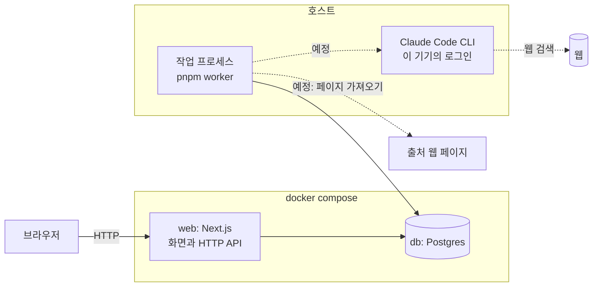
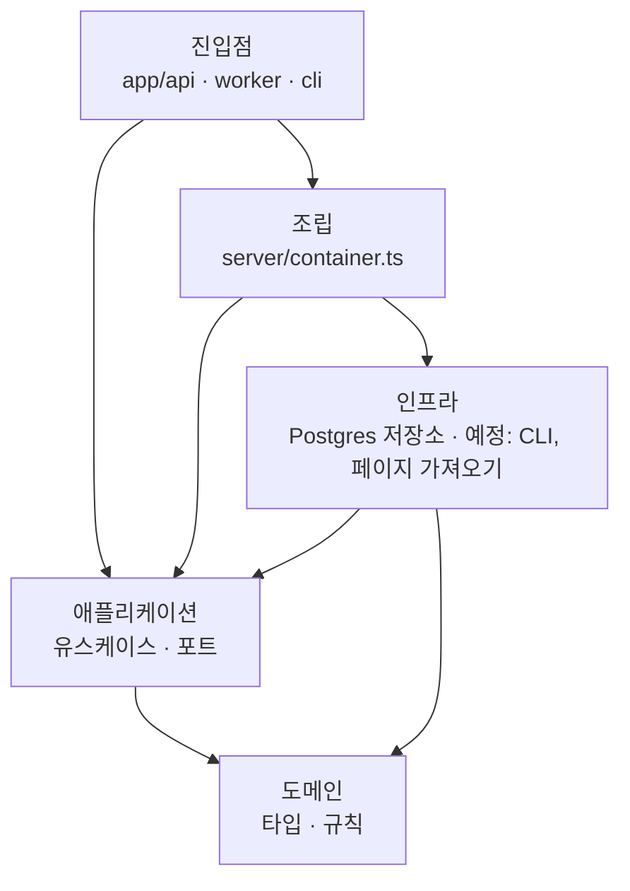
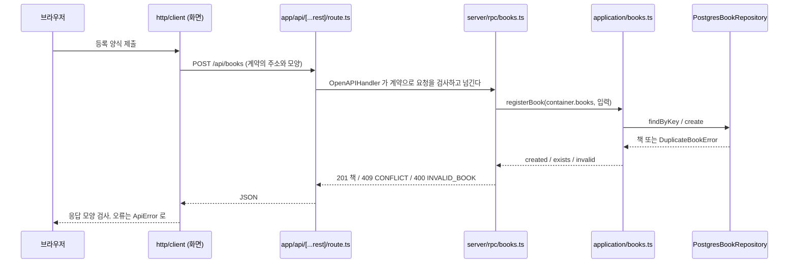
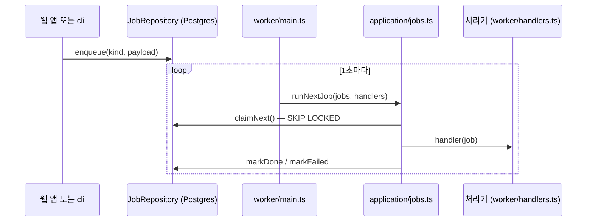
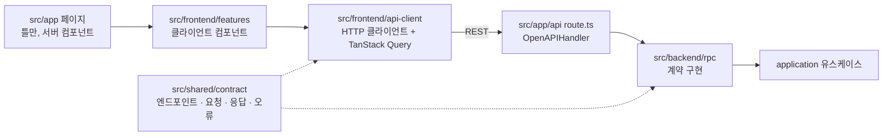

# inkle 아키텍처

> 시스템이 어떻게 생겼는지 한곳에서 본다. 각 결정의 이유와 대안은 ADR 에 있다 (`docs/decisions/README.md`).
> **현재**는 코드에 있는 것, **예정**은 ADR 로 정했지만 아직 만들지 않은 것이다.
> 마지막 갱신: 2026-11-17 (spec-01-04).

## 1. 한눈에



| 실행 단위 | 어디서 | 하는 일 | 상태 | 근거 |
|---|---|---|---|---|
| web | compose | 화면, HTTP API. 뜰 때 마이그레이션 적용 | 현재 | ADR-001 |
| db | compose | 모든 자료와 작업 대기열. `127.0.0.1:54329` | 현재 | ADR-001 |
| 작업 프로세스 | 호스트 | 대기열의 작업을 처리 | 현재 (시험용 작업만) | ADR-001, ADR-004 |
| Claude Code CLI | 호스트 | LLM 호출. 구독 로그인, API 키 없음 | 예정 (spec-01-06) | ADR-004 |

작업 프로세스가 호스트에서 뜨는 이유: CLI 를 이 기기의 로그인으로 쓰기 때문이다. 컨테이너 안의 토큰 로그인은 확인하지 않았다 (ADR-004 §가정의 확인 결과).

## 2. src 의 배치

ADR-008. backend 와 frontend 는 서로 가져오지 않고 shared 만 함께 쓴다.

| 영역 | 내용 | 가져올 수 없는 것 |
|---|---|---|
| `src/app/` | Next.js 라우트 (얕은 입구). 페이지는 frontend, `api/` 는 backend | (api 제외) backend |
| `src/frontend/` | features, ui, api-client, providers, testing | backend, DB |
| `src/backend/` | domain, application, infrastructure, rpc, container, worker, cli, testing | frontend, React, Next.js |
| `src/shared/` | contract (HTTP 계약), product | 모든 영역, React, Next.js, DB |

## 2-1. 서버 계층

ADR-006. 의존은 바깥에서 안쪽으로만 간다.



| 계층 | 폴더 | 담는 것 | 금지 |
|---|---|---|---|
| 도메인 | `src/backend/domain/` | 타입, 상수, 순수한 규칙 | DB, 프레임워크, 다른 계층 |
| 애플리케이션 | `src/backend/application/` | 유스케이스 함수, 포트(`ports.ts`) | DB, 프레임워크, 인프라, 조립, 진입점 |
| 인프라 | `src/backend/infrastructure/` | 포트 구현, DB 연결과 마이그레이션 | 조립, 진입점 |
| 조립 | `src/backend/container.ts` | 실제 구현을 만들어 묶는다 | - |
| 진입점 | `src/app/`, `src/backend/worker/`, `src/backend/cli/` | 입력을 받아 유스케이스를 부른다 | SQL 직접 실행 |

금지 항목은 lint 가 막는다 (`eslint.config.mjs`).

### 포트

| 포트 | 하는 일 | 구현 | 상태 |
|---|---|---|---|
| `HealthProbe` | DB 에 닿는지 | `PostgresHealthProbe` | 현재 |
| `UserRepository` | 사용자 찾기 | `PostgresUserRepository` | 현재 |
| `JobRepository` | 작업 넣기, 가져가기, 끝내기, 실패 기록 | `PostgresJobRepository` | 현재 |
| `BookRepository` | 책 만들기, 찾기(번호, 정규화한 키), 목록 | `PostgresBookRepository` | 현재 |
| 모임, 내 해석, 출처, 시선 … 저장소 | ADR-002 의 자료 | Postgres | 예정 (spec-01-05 ~) |
| `LlmClient` | 지시문과 결과 형식을 주고 결과를 받는다 | Claude Code CLI (이후 Claude API) | 예정 (spec-01-06) |
| `PageFetcher` | 주소를 열어 본문 글자를 받는다 | HTTP 요청 + 본문 추출 | 예정 (spec-01-06) |

## 3. 흐름

### HTTP 요청 (현재: 상태 확인, 책)



화면은 HTTP API 로만 자료를 읽고 쓴다 (ADR-001 §4).

### 작업 (현재: 시험용 작업)



등록되지 않은 종류의 작업과 처리기의 예외는 `failed` 와 이유로 남는다.

### 자료 수집 (예정: spec-01-06)

ADR-004 §2. 찾기(LLM, 웹 검색만) → 가져오기(코드) → 읽기(LLM, 도구 없음) → 대조(코드, 문자열). 대조를 통과한 인용이 없는 항목은 내주지 않는다. 책 단위로 저장해 재사용한다 (ADR-002). 결과는 내 해석이 저장된 모임에만 내준다 (ADR-004 §7).

## 4. 데이터

ADR-002. 자료는 두 층이다.

| 층 | 자료 | 사용자 식별자 | 상태 |
|---|---|:---:|---|
| 책 단위 | 책 | 없음 | 현재 (spec-01-04) |
| 책 단위 | 출처, 배경 항목, 시선 | 없음 | 예정 |
| 독자 단위 | 모임, 내 해석, 연결, 비교, 끝의 한 번 고르기, 토론, 노트 | 있음 (ADR-003) | 예정 |
| 운영 | 사용자, 작업 대기열, 적용한 마이그레이션 | - | 현재 |

- 모든 글에 글쓴이(나 / AI / 외부 사람)를 따로 저장한다 (ADR-002 §3).
- 원본은 덧붙이기만 하고, 파생물은 만든 재료와 지시문의 판을 남긴다 (ADR-005).
- 스키마는 `src/backend/infrastructure/db/migrations/` 의 번호 붙은 SQL 파일로 관리한다. ORM 은 쓰지 않는다.
- 같은 책은 하나만 있다. 정규화한 제목과 작가(`books.key`)에 유일 인덱스를 둔다.

## 5. 테스트

ADR-006 §4, ADR-007 §8.

| 종류 | 위치 | 도구 | 실제 DB |
|---|---|---|:---:|
| 유스케이스, 도메인 규칙 | `src/backend/application/`, `src/backend/domain/` (메모리 구현 사용) | Vitest (Node) | 불필요 |
| 저장소 계약 | `src/backend/testing/contracts/` 를 메모리와 Postgres 양쪽에 | Vitest (Node) | Postgres 쪽만 |
| Postgres 고유 성질 (동시성, 마이그레이션) | `src/backend/infrastructure/**/*.test.ts` | Vitest (Node) | 필요 |
| API 처리, 엔드포인트 문서 | `src/backend/rpc/*.test.ts` (메모리 문맥으로 직접 호출) | Vitest (Node) | 불필요 |
| HTTP 클라이언트 | `src/frontend/api-client/*.test.ts` | Vitest (Node) | 불필요 |
| 화면 컴포넌트 | `src/frontend/features/**/*.test.tsx` (HTTP 는 MSW) | Vitest 브라우저 모드 (Chromium) | 불필요 |
| 의존 규칙, UI 일관성 | `src/architecture.test.ts` | ESLint 를 코드로 실행 | 불필요 |
| 흐름 (E2E) | `e2e/` | Playwright, compose 로 띄운 앱 | 필요 |

```bash
pnpm test:unit                    # 실제 DB 없이
docker compose up -d --wait
pnpm test                         # 전부 (inkle_test 데이터베이스를 비우고 쓴다)
pnpm test:e2e                     # 흐름
```

## 6. 프론트

ADR-007.



| 주제 | 정한 것 |
|---|---|
| 라우터 | App Router. 페이지는 자료를 읽지 않는 틀. `typedRoutes`. 주소 상태는 nuqs |
| 상태 | 서버 자료 TanStack Query, 주소 nuqs, 양식 React Hook Form + zod. 전역 저장소 없음 (Zustand 는 필요해질 때) |
| HTTP | oRPC 1.x 계약 하나에서 엔드포인트·요청·응답·오류를 정한다. REST 주소와 `/api/openapi.json`. 화면은 `src/frontend/api-client/` 만 거친다 (`fetch` 직접 사용 금지). Server Actions 없음 |
| UI | Tailwind 4 만. shadcn/ui(Radix) 부품을 `src/frontend/ui/` 에. 테마 값은 `globals.css` 토큰에서만. `@shadcn/lint` 로 강제 |
| 테스트 | API 처리와 HTTP 클라이언트는 Vitest(Node), 컴포넌트는 Vitest 브라우저 모드 + MSW, 흐름은 Playwright |
| 기타 | React Compiler |

화면의 의존 규칙은 ADR-007 §7. 글쓰기와 글쓴이 표시의 공통 규칙은 ADR-007 §5 (spec-01-05, 07 에서 만든다).

## 7. 결정 목록

| ADR | 내용 |
|---|---|
| 001 | 단일 Next.js 앱, 작업 프로세스, Postgres 대기열, 화면은 HTTP API 만 |
| 002 | 책 단위와 독자 단위 두 층, 시선은 하나의 개념, 글쓴이 구분 |
| 003 | 독자 단위 자료에 사용자 식별자, 인증 없는 로컬 사용자 |
| 004 | Claude Code CLI, 앱이 출처를 직접 열어 문자열 대조 |
| 005 | 원본은 덧붙이기만, 파생물은 재료를 기록 |
| 006 | 서버 세 계층, 저장소 인터페이스, 계약 테스트 |
| 007 | 프론트: 틀만 그리는 페이지, 기능 단위 클라이언트 컴포넌트, oRPC 계약, shadcn/ui 와 토큰 |

## 8. 이 문서를 고칠 때

계층, 실행 단위, 포트, 흐름이 바뀌는 spec 은 이 문서를 함께 고친다. "예정"이 "현재"가 되면 표의 상태를 바꾼다.
