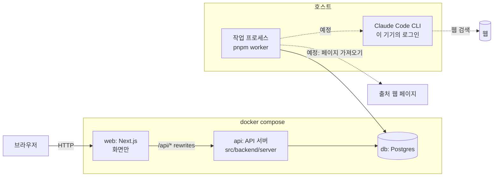
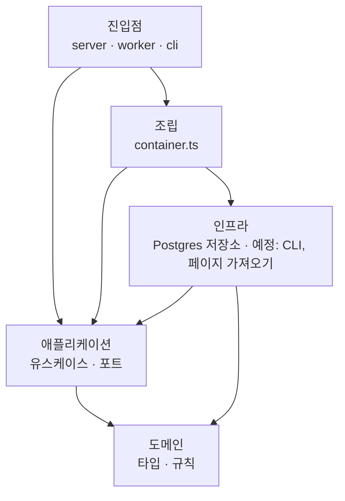
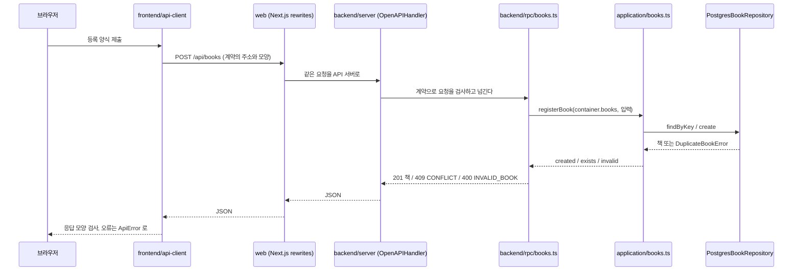
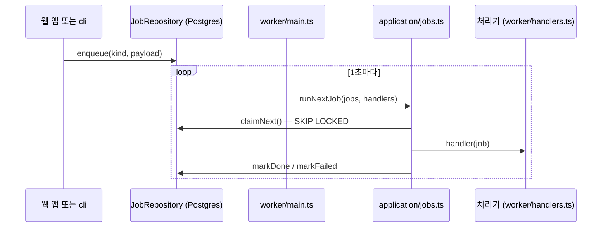
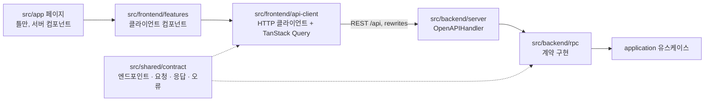

# inkle 아키텍처

> 시스템이 어떻게 생겼는지 한곳에서 본다. 각 결정의 이유와 대안은 ADR 에 있다 (`docs/decisions/README.md`).
> **현재**는 코드에 있는 것, **예정**은 ADR 로 정했지만 아직 만들지 않은 것이다.
> 마지막 갱신: 2026-11-17 (spec-01-04, API 서버 분리).

## 1. 한눈에



| 실행 단위 | 어디서 | 시작 명령 | 하는 일 | 근거 |
|---|---|---|---|---|
| web | compose, `127.0.0.1:3000` | `pnpm dev` | 화면. `/api/*` 는 API 서버로 넘긴다 (`next.config.ts` 의 rewrites, `API_ORIGIN`) | ADR-007, ADR-009 |
| api | compose, `127.0.0.1:4000` | `pnpm db:migrate && pnpm api` | HTTP API (계약의 주소, `/api/openapi.json`). 뜰 때 마이그레이션 적용 | ADR-009 |
| db | compose, `127.0.0.1:54329` | - | 모든 자료와 작업 대기열 | ADR-001 |
| 작업 프로세스 | 호스트 | `pnpm worker` | 대기열의 작업을 처리 (지금은 시험용 작업만) | ADR-001, ADR-004 |
| Claude Code CLI | 호스트 | - | LLM 호출. 구독 로그인, API 키 없음 (예정, spec-01-08) | ADR-004 |

- web, api, 작업 프로세스는 같은 저장소의 같은 코드이고, 컨테이너는 같은 이미지에서 시작 명령만 다르다.
- 작업 프로세스가 호스트에서 뜨는 이유: CLI 를 이 기기의 로그인으로 쓰기 때문이다 (ADR-004 §가정의 확인 결과).
- 브라우저는 같은 주소의 `/api` 만 안다. API 가 다른 서버라는 사실은 Next.js 의 rewrites 한 곳에만 있다.

## 2. 현재 구조: 한 저장소, 세 영역

ADR-008, ADR-009. 저장소와 빌드는 하나이고, `src` 는 영역으로 나뉜다. backend 와 frontend 는 서로 가져오지 않고 shared 만 함께 쓴다. 규칙은 lint 가 막고 `src/architecture.test.ts` 가 확인한다.

```
inkle/
├─ src/
│  ├─ app/                Next.js 화면 라우트 (틀만). frontend 를 배치한다
│  ├─ frontend/
│  │  ├─ features/        기능별 화면 (books, system)
│  │  ├─ ui/              shadcn/ui 공통 부품
│  │  ├─ api-client/      HTTP 클라이언트 (화면이 서버를 부르는 유일한 통로)
│  │  ├─ providers.tsx    TanStack Query, nuqs
│  │  └─ testing/         MSW, 브라우저 렌더링 도우미
│  ├─ backend/
│  │  ├─ domain/          타입과 규칙
│  │  ├─ application/     유스케이스, 포트
│  │  ├─ infrastructure/  Postgres 저장소, 마이그레이션
│  │  ├─ rpc/             계약 구현, OpenAPI 문서
│  │  ├─ server/          API 서버 (진입점: main.ts)
│  │  ├─ container.ts     조립
│  │  ├─ worker/          작업 프로세스 (진입점: main.ts)
│  │  ├─ cli/             db:migrate, job:enqueue
│  │  └─ testing/         메모리 저장소, 저장소 계약, 테스트 DB
│  ├─ shared/
│  │  ├─ contract/        HTTP 계약 (엔드포인트 · 요청 · 응답 · 오류)
│  │  └─ product.ts
│  └─ architecture.test.ts
├─ e2e/                   Playwright
├─ docker/, Dockerfile, compose.yaml
└─ package.json, next.config.ts, vitest.config.mts, eslint.config.mjs, tsconfig.json
```

| 영역 | 가져올 수 있는 것 | 가져올 수 없는 것 |
|---|---|---|
| `src/app/` | frontend, shared | backend, DB |
| `src/frontend/` | shared, React, Next.js | backend, DB |
| `src/backend/` | shared, DB | frontend, React, Next.js |
| `src/shared/` | `zod`, `@orpc/contract` | 모든 영역, React, Next.js, DB |

### 지금 한 저장소에 묶여 있는 것

모노레포로 나눌 때 풀어야 하는 것들이다.

| 묶인 것 | 지금 | 
|---|---|
| 의존성 | `package.json` 하나에 화면(React, Next.js, shadcn/ui …)과 서버(postgres, oRPC 서버 …)의 의존성이 함께 있다 |
| 경로 별칭 | `@/` 하나가 `src/` 전체를 가리킨다 (`tsconfig.json`, `vitest.config.mts`) |
| 경계 강제 | 패키지가 아니라 lint 규칙(`eslint.config.mjs`)이 영역 경계를 지킨다 |
| 테스트 | `vitest.config.mts` 하나에 Node 프로젝트(서버, 계약)와 브라우저 프로젝트(화면)가 있다 |
| 이미지 | `Dockerfile` 하나를 web, api, worker 가 함께 쓴다 |
| 계약 | `src/shared/contract/` 를 두 쪽이 소스로 직접 가져온다 (빌드된 패키지가 아님) |
| API 주소 | 화면은 같은 주소의 `/api` 를 부르고, Next.js rewrites 가 API 서버로 넘긴다 |

## 2-0. 모노레포로 옮길 때

**결정 (2026-11-17)**: 지금 옮긴다. 서버가 둘(화면, API)과 작업 프로세스로 나뉘었으니 앱이 셋이고, 코드가 적은 지금이 가장 싸다. PR #4 다음 spec(spec-01-05 모노레포 전환)에서 이 절의 대응표와 순서대로 옮긴다. 화면을 정적으로 배포할지는 따로 열어 둔다 (`docs/goals.md` §열린 질문).

### 대응표

| 지금 | 모노레포 | 비고 |
|---|---|---|
| `src/app/`, `src/frontend/` | `apps/web/` | `src/frontend/*` 는 `apps/web/src/` 아래로. 정적 내보내기를 쓰면 Next.js `output: "export"` 또는 Vite SPA |
| `src/backend/server/` | `apps/api/` (진입점) | `main.ts` 와 `http-server.ts` |
| `src/backend/worker/` | `apps/worker/` (진입점) | |
| `src/backend/cli/` | `apps/api/` 의 스크립트 또는 `packages/backend` 의 bin | |
| `src/backend/domain/`, `application/`, `infrastructure/`, `rpc/`, `container.ts` | `packages/backend/` | 세 진입점(api, worker, cli)이 함께 쓴다. 계층 규칙(ADR-006)은 패키지 안에서 그대로 |
| `src/backend/testing/` | `packages/backend/` 의 테스트 도우미 | |
| `src/shared/contract/` | `packages/contract/` | 의존성은 `zod`, `@orpc/contract` 뿐이라 그대로 옮겨진다 |
| `src/frontend/ui/` | `apps/web/` 안에 두거나 `packages/ui/` | 화면이 하나뿐이면 apps/web 안에 둔다 |
| `src/architecture.test.ts` | 패키지 경계로 대부분 대체. 계층 규칙만 `packages/backend` 의 lint 로 남긴다 | |
| `Dockerfile` 하나 | 앱마다 하나 (web 은 정적이면 이미지가 필요 없을 수 있다) | |
| Next.js rewrites | 개발 중에는 그대로, 배포에서는 같은 도메인의 경로로 넘기거나 CORS 를 연다 | `src/frontend/api-client/` 의 `origin` 옵션을 쓴다 |

### 옮기는 순서 (제안)

1. `pnpm-workspace.yaml` 을 만들고 `packages/contract` 부터 옮긴다. 가져오기 경로를 `@/shared/contract` 에서 패키지 이름으로 바꾼다.
2. `packages/backend` 를 옮긴다. `apps/api`, `apps/worker` 진입점을 만들고 compose 의 시작 명령을 바꾼다.
3. `apps/web` 을 옮긴다. 의존성을 앱별 `package.json` 으로 나눈다.
4. 정적 배포를 고르면: 동적 주소(`/books/{bookId}`)를 클라이언트 라우팅으로 바꾸고, Next.js rewrites 대신 배포 환경의 경로 전달이나 CORS 를 쓴다.
5. lint 의 영역 규칙을 패키지 의존성(각 `package.json` 에 없는 패키지는 가져올 수 없음)으로 대체하고, `src/architecture.test.ts` 에서 남길 것만 남긴다.

### 옮기기 쉽게 하려고 지금 지키는 것

- frontend 와 backend 는 서로 가져오지 않는다 (lint).
- 계약(`src/shared/contract/`)은 React, Next.js, DB 를 가져오지 않는다 (lint).
- 페이지에서 서버 자료를 읽지 않는다. 요청 시점의 API(`headers()`, `cookies()`)를 쓰지 않는다 (ADR-007 §1).
- Server Actions 를 쓰지 않는다 (ADR-007 §3).
- API 주소는 HTTP 클라이언트 한 곳에서만 정하고, API 가 다른 서버라는 사실은 rewrites 한 곳에만 둔다.

이 가운데 하나라도 깨야 하는 기능이 생기면, 그 spec 에서 이 절을 먼저 다시 본다.

## 2-1. 서버 계층

ADR-006. 의존은 바깥에서 안쪽으로만 간다.



| 계층 | 폴더 | 담는 것 | 금지 |
|---|---|---|---|
| 도메인 | `src/backend/domain/` | 타입, 상수, 순수한 규칙 | DB, 프레임워크, 다른 계층 |
| 애플리케이션 | `src/backend/application/` | 유스케이스 함수, 포트(`ports.ts`) | DB, 프레임워크, 인프라, 조립, 진입점 |
| 인프라 | `src/backend/infrastructure/` | 포트 구현, DB 연결과 마이그레이션 | 조립, 진입점 |
| 조립 | `src/backend/container.ts` | 실제 구현을 만들어 묶는다 | - |
| 진입점 | `src/app/`, `src/backend/worker/`, `src/backend/cli/` | 입력을 받아 유스케이스를 부른다 | SQL 직접 실행 |

금지 항목은 lint 가 막는다 (`eslint.config.mjs`).

### 포트

| 포트 | 하는 일 | 구현 | 상태 |
|---|---|---|---|
| `HealthProbe` | DB 에 닿는지 | `PostgresHealthProbe` | 현재 |
| `UserRepository` | 사용자 찾기 | `PostgresUserRepository` | 현재 |
| `JobRepository` | 작업 넣기, 가져가기, 끝내기, 실패 기록 | `PostgresJobRepository` | 현재 |
| `BookRepository` | 책 만들기, 찾기(번호, 정규화한 키), 목록 | `PostgresBookRepository` | 현재 |
| 모임, 내 해석, 출처, 시선 … 저장소 | ADR-002 의 자료 | Postgres | 예정 (spec-01-07 ~) |
| `LlmClient` | 지시문과 결과 형식을 주고 결과를 받는다 | Claude Code CLI (이후 Claude API) | 예정 (spec-01-08) |
| `PageFetcher` | 주소를 열어 본문 글자를 받는다 | HTTP 요청 + 본문 추출 | 예정 (spec-01-08) |

## 3. 흐름

### HTTP 요청 (현재: 상태 확인, 책)



화면은 HTTP API 로만 자료를 읽고 쓴다 (ADR-001 §4).

### 작업 (현재: 시험용 작업)



등록되지 않은 종류의 작업과 처리기의 예외는 `failed` 와 이유로 남는다.

### 자료 수집 (예정: spec-01-08)

ADR-004 §2. 찾기(LLM, 웹 검색만) → 가져오기(코드) → 읽기(LLM, 도구 없음) → 대조(코드, 문자열). 대조를 통과한 인용이 없는 항목은 내주지 않는다. 책 단위로 저장해 재사용한다 (ADR-002). 결과는 내 해석이 저장된 모임에만 내준다 (ADR-004 §7).

## 4. 데이터

ADR-002. 자료는 두 층이다.

| 층 | 자료 | 사용자 식별자 | 상태 |
|---|---|:---:|---|
| 책 단위 | 책 | 없음 | 현재 (spec-01-04) |
| 책 단위 | 출처, 배경 항목, 시선 | 없음 | 예정 |
| 독자 단위 | 모임, 내 해석, 연결, 비교, 끝의 한 번 고르기, 토론, 노트 | 있음 (ADR-003) | 예정 |
| 운영 | 사용자, 작업 대기열, 적용한 마이그레이션 | - | 현재 |

- 모든 글에 글쓴이(나 / AI / 외부 사람)를 따로 저장한다 (ADR-002 §3).
- 원본은 덧붙이기만 하고, 파생물은 만든 재료와 지시문의 판을 남긴다 (ADR-005).
- 스키마는 `src/backend/infrastructure/db/migrations/` 의 번호 붙은 SQL 파일로 관리한다. ORM 은 쓰지 않는다.
- 같은 책은 하나만 있다. 정규화한 제목과 작가(`books.key`)에 유일 인덱스를 둔다.

## 5. 테스트

ADR-006 §4, ADR-007 §8.

| 종류 | 위치 | 도구 | 실제 DB |
|---|---|---|:---:|
| 유스케이스, 도메인 규칙 | `src/backend/application/`, `src/backend/domain/` (메모리 구현 사용) | Vitest (Node) | 불필요 |
| 저장소 계약 | `src/backend/testing/contracts/` 를 메모리와 Postgres 양쪽에 | Vitest (Node) | Postgres 쪽만 |
| Postgres 고유 성질 (동시성, 마이그레이션) | `src/backend/infrastructure/**/*.test.ts` | Vitest (Node) | 필요 |
| API 처리, 엔드포인트 문서 | `src/backend/rpc/*.test.ts` (메모리 문맥으로 직접 호출) | Vitest (Node) | 불필요 |
| API 서버 (HTTP 상태, 문서, 없는 주소) | `src/backend/server/*.test.ts` (실제 HTTP 서버, 메모리 문맥) | Vitest (Node) | 불필요 |
| HTTP 클라이언트 | `src/frontend/api-client/*.test.ts` | Vitest (Node) | 불필요 |
| 화면 컴포넌트 | `src/frontend/features/**/*.test.tsx` (HTTP 는 MSW) | Vitest 브라우저 모드 (Chromium) | 불필요 |
| 의존 규칙, UI 일관성 | `src/architecture.test.ts` | ESLint 를 코드로 실행 | 불필요 |
| 흐름 (E2E) | `e2e/` | Playwright, compose 로 띄운 앱 | 필요 |

```bash
pnpm test:unit                    # 실제 DB 없이
docker compose up -d --wait
pnpm test                         # 전부 (inkle_test 데이터베이스를 비우고 쓴다)
pnpm test:e2e                     # 흐름
```

## 6. 프론트

ADR-007.



| 주제 | 정한 것 |
|---|---|
| 라우터 | App Router. 페이지는 자료를 읽지 않는 틀. `typedRoutes`. 주소 상태는 nuqs |
| 상태 | 서버 자료 TanStack Query, 주소 nuqs, 양식 React Hook Form + zod. 전역 저장소 없음 (Zustand 는 필요해질 때) |
| HTTP | oRPC 1.x 계약 하나에서 엔드포인트·요청·응답·오류를 정한다. REST 주소와 엔드포인트 문서. API 는 별도 서버(ADR-009). 화면은 `src/frontend/api-client/` 만 거친다 (`fetch` 직접 사용 금지). Server Actions 없음 |
| UI | Tailwind 4 만. shadcn/ui(Radix) 부품을 `src/frontend/ui/` 에. 테마 값은 `globals.css` 토큰에서만. `@shadcn/lint` 로 강제 |
| 테스트 | API 처리와 HTTP 클라이언트는 Vitest(Node), 컴포넌트는 Vitest 브라우저 모드 + MSW, 흐름은 Playwright |
| 기타 | React Compiler |

화면의 의존 규칙은 ADR-007 §7. 글쓰기와 글쓴이 표시의 공통 규칙은 ADR-007 §5 (spec-01-07, 07 에서 만든다).

## 7. 결정 목록

| ADR | 내용 |
|---|---|
| 001 | 작업 프로세스, Postgres 대기열, 화면은 HTTP API 만 (§1·§2 는 ADR-009 가 대체) |
| 002 | 책 단위와 독자 단위 두 층, 시선은 하나의 개념, 글쓴이 구분 |
| 003 | 독자 단위 자료에 사용자 식별자, 인증 없는 로컬 사용자 |
| 004 | Claude Code CLI, 앱이 출처를 직접 열어 문자열 대조 |
| 005 | 원본은 덧붙이기만, 파생물은 재료를 기록 |
| 006 | 서버 세 계층, 저장소 인터페이스, 계약 테스트 |
| 007 | 프론트: 틀만 그리는 페이지, 기능 단위 클라이언트 컴포넌트, oRPC 계약, shadcn/ui 와 토큰 |
| 008 | `src` 를 backend · frontend · shared 로 |
| 009 | API 는 Next.js 와 다른 서버로, Next.js 는 화면만 |

## 8. 이 문서를 고칠 때

계층, 실행 단위, 포트, 흐름이 바뀌는 spec 은 이 문서를 함께 고친다. "예정"이 "현재"가 되면 표의 상태를 바꾼다.
