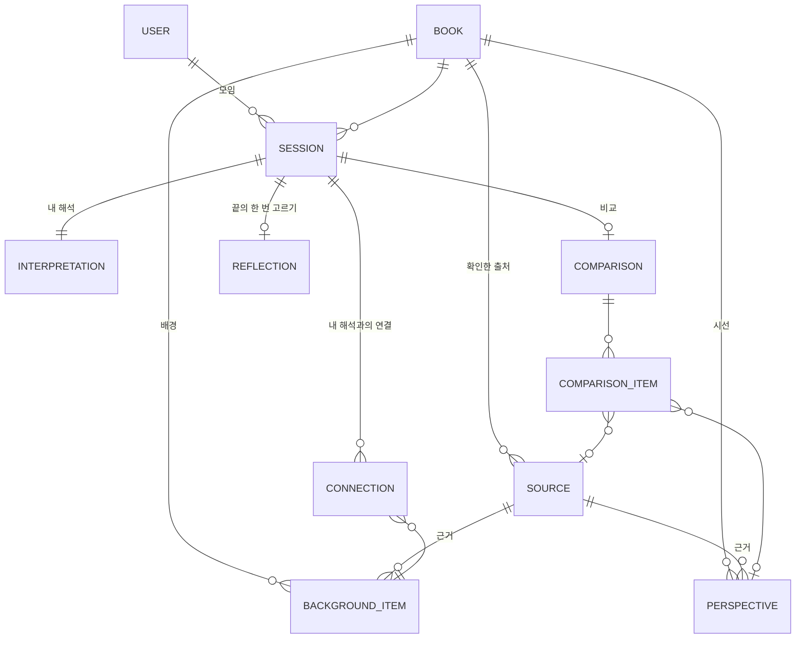

# ADR-002: 자료를 책 단위와 독자 단위 두 층으로 나누고, 시선은 하나의 개념으로 둔다

## 📚 Context

- 출처를 열어 확인하는 비용이 크다. 같은 책의 배경과 시선을 독자마다 다시 찾으면 비용과 대기 시간을 감당하기 어렵다 (`docs/experiments/01-manual-flow/findings.md` 확인된 것 9, 입력 3).
- "다른 시선"에는 지금 출처가 있는 실제 사람의 시선과 AI 가 만든 해석이 들어가고, 3단계에서는 inkle 독자가 공개한 해석이 섞인다 (`docs/goals.md` §단계).
- 원칙 "내 글과 AI 글을 섞지 않는다", "실제 사람의 시선이 먼저다"는 누가 쓴 글인지를 저장 단계에서 구분해야 지킬 수 있다.
- 찾아지는 시선은 다수 의견으로 쏠리고, 독자의 해석이 그와 다른 지점을 "드문 읽기"로 보여줘야 한다 (입력 5).
- 1단계는 소설만 다루지만 비문학을 나중에 추가할 수 있어야 한다 (입력 8).

## 🎯 Decision

### 1. 두 층

| 층 | 개념 | 뜻 |
|---|---|---|
| 책 단위 (독자와 무관, 재사용) | 책 | 제목, 작가, 장르 |
| | 출처 | 실제로 열어 확인한 글 하나. 주소, 글쓴이나 매체, 확인한 시각 |
| | 배경 항목 | 작품의 시대, 작가의 삶과 의도에 대한 사실 하나. 출처와 인용 문장을 가진다 |
| | 시선 | 이 책을 이렇게 읽었다는 해석 하나 |
| 독자 단위 (사용자 식별자를 가짐) | 모임 | 한 독자가 한 책을 두고 연 한 번의 모임. 같은 책으로 다시 열 수 있다 |
| | 내 해석 | 질문별 답. 모임마다 하나 |
| | 연결 | 배경 항목 하나가 내 해석의 어느 부분과 맞닿는지 |
| | 비교 | "책과 어긋나는 곳"과 "다르게 읽은 곳"의 항목들 |
| | 끝의 한 번 고르기 | "새로 알게 된 것이 있었나 / 생각이 달라졌나"의 답 |

토론 대화와 노트(선택 단계)도 독자 단위이며 모임에 딸린다. 구조는 spec-01-09, spec-01-10 에서 정하되 ADR-005 의 원본 규칙을 따른다.

### 2. 시선은 하나의 개념이다

시선은 종류를 속성으로 가진다.

| 종류 | 지금 | 필수로 가지는 것 |
|---|:---:|---|
| 외부 사람 (평론가, 작가 본인, 일반 독자) | O | 출처, 인용 문장, 누가 한 말인지 |
| AI 가 만든 해석 | O (실제 자료가 부족할 때만) | AI 가 썼다는 표시. 출처 없음 |
| inkle 독자 | 3단계 | 공개한 독자의 해석을 가리킴 |

시선마다 **얼마나 흔한 읽기인가**(다수 의견 / 일부 / 드문 읽기 / 알 수 없음)를 가진다. 이 값은 수집 때 찾은 자료의 분포로 정하고, 근거가 약하면 "알 수 없음"으로 둔다.

### 3. 글쓴이 구분

글로 된 모든 자료는 글쓴이의 종류(나 / AI / 외부 사람)를 가진다. 한 화면에 여러 글쓴이의 글이 함께 보이더라도 저장은 글쓴이별로 따로 한다. 한 필드 안에 내 문장과 AI 문장을 이어 붙여 저장하지 않는다.

- 내 해석, 노트의 "달라진 점", 토론에서 내가 한 말: **나**
- 연결, 비교, AI 가 만든 해석, 모임 기록 정리, 외부 글을 한국어로 옮기거나 줄인 문장: **AI**
- 출처에서 그대로 가져온 인용 문장: **외부 사람**

외부 글을 다룰 때는 인용 문장(외부 사람)과 그것을 설명하는 문장(AI)을 따로 저장한다.

### 4. 장르

장르는 책의 속성이다. 내 해석의 질문 묶음과 화면의 표현("책과 어긋나는 곳"의 설명 등)은 장르를 보고 고른다. 지금은 소설용만 만든다.

### 5. 근거의 종류

비교의 "책과 어긋나는 곳" 항목은 근거의 종류(출처 확인 / 모델의 기억)를 가진다. 출처 확인이면 출처와 인용 문장을 가리킨다 (입력 6). 검증 방식은 ADR-004 에서 정한다.

## 📊 Consequences

- **긍정**: 같은 책으로 두 번째 모임을 열 때 자료를 다시 모으지 않는다. 독자별로 새로 만드는 것은 연결과 비교뿐이다.
- **긍정**: 책 단위 층은 3단계의 책별 공유 위키가 그대로 쓸 수 있다.
- **긍정**: inkle 독자의 해석이 들어올 때 시선의 종류 하나만 추가하면 화면과 비교 로직이 그대로 동작한다.
- **긍정**: 2단계의 위키와 취향 분석이 "내가 쓴 문장"만 골라 근거로 삼을 수 있다.
- **부정**: 책 단위 자료는 모은 시점의 것이다. 새 평론이 나와도 다시 모으기 전에는 반영되지 않는다. 다시 모으는 시점과 방법은 정하지 않았다.
- **부정**: 책 단위 자료는 특정 독자의 해석에 맞춰 찾은 것이 아니다. 독자의 해석과 맞닿는 자료가 없을 수 있다. 1단계에서는 책 단위로 넓게 모으고, 독자의 해석에 맞춘 추가 검색은 점검 2 의 결과를 보고 정한다.
- **부정**: "얼마나 흔한 읽기인가"는 검색으로 찾은 자료의 분포에 기대므로 실제 독자 분포와 다를 수 있다. 화면에서 단정하지 않고 "찾은 자료 가운데"라고 표현한다.
- **중립**: 같은 책의 판본과 번역본은 구분하지 않는다. 책은 제목과 작가로 식별한다.

## 🔀 Alternatives

- **모든 자료를 모임에 딸리게 저장** (책 단위 층 없음): 구조가 단순하고 독자의 해석에 맞춘 자료만 남는다 — 비채택 이유: 같은 책을 다시 열 때마다 수집 비용을 낸다. 책별 공유 위키로 이어지지 않는다.
- **시선을 종류별로 다른 개념으로 저장** (평론 / AI 해석 / 독자 해석): 종류마다 필요한 속성만 가진다 — 비채택 이유: 비교와 화면이 세 가지를 따로 다뤄야 하고, 3단계에서 독자 해석이 추가될 때 그 로직을 모두 고쳐야 한다.
- **글쓴이를 문서 단위로만 표시**: 저장이 단순하다 — 비채택 이유: 노트처럼 내 글과 AI 정리가 함께 있는 문서에서 내 문장만 골라낼 수 없다.

## 📌 Status

Proposed (2026-11-17, spec-01-02). PR 병합 시 accepted. 첫 적용: spec-01-04 책 등록.

## 🔗 Related

- `docs/experiments/01-manual-flow/findings.md` 입력 3, 5, 6, 7, 8
- `docs/goals.md` §원칙, §단계
- ADR-003 (사용자 식별자의 범위), ADR-004 (출처 검증), ADR-005 (원본과 파생물)
