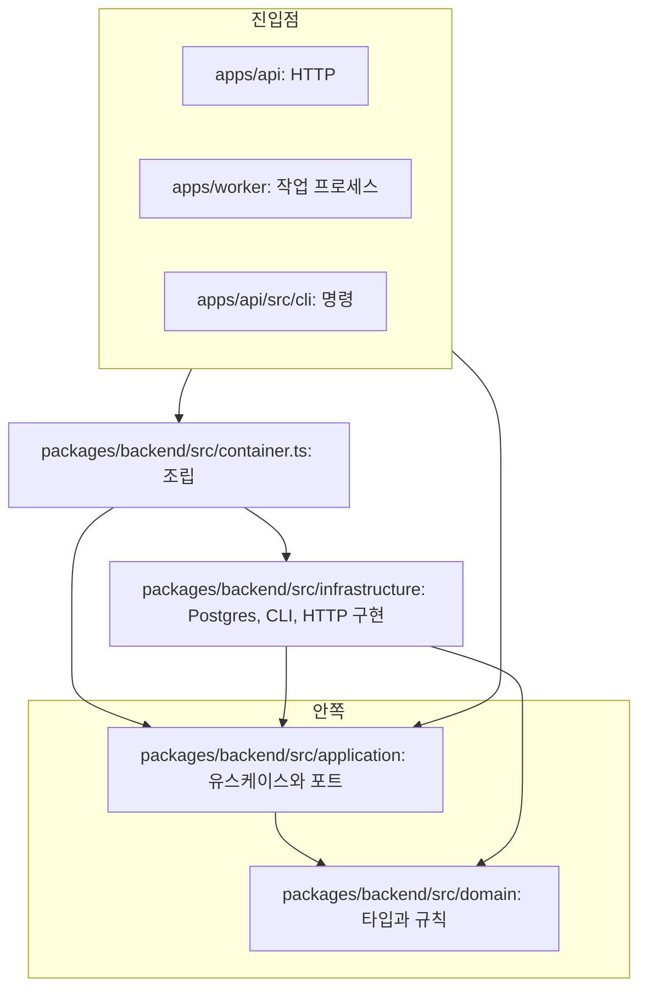

# ADR-006: 서버 코드는 세 계층으로 나누고, DB 와 외부 시스템은 저장소 인터페이스 뒤에 둔다

## 📚 Context

- spec-01-03 의 첫 구현은 `packages/backend/src/domain/` 의 함수가 `postgres` 연결을 받아 SQL 을 직접 실행했다. 규칙과 DB 접근이 한 파일에 섞여 있어, 작업 처리 순서 같은 규칙 하나를 확인할 때도 실제 DB 가 필요했다.
- 사용자 요청 (2026-11-17, PR #3 리뷰): 단순한 클린 아키텍처로 나누고, DB 접근은 저장소(repository) 패턴 뒤에 둔다. 테스트도 그 구조를 활용한다.
- 이후 spec 은 DB 말고도 바깥 시스템을 부른다. Claude Code CLI(ADR-004 §1 의 LLM 호출 경계)와 출처 페이지 가져오기(ADR-004 §2)다. 이 둘도 같은 방식으로 감싸야 테스트에서 바꿔 끼울 수 있다.
- phase-01 성공 기준 5("내 해석 저장 전에는 시선과 비교를 내주지 않는다")는 자동 테스트로 검증해야 한다. 이 규칙은 DB 없이 확인할 수 있어야 테스트가 빠르고 많아질 수 있다.
- ADR-001 §4 는 "DB 를 읽고 쓰는 코드는 모두 도메인 모듈에 둔다"고 적었다. 이 ADR 이 그 "도메인 모듈"을 아래의 계층으로 구체화한다.

## 🎯 Decision

### 1. 계층



| 계층 | 폴더 | 담는 것 | 가져올 수 있는 것 |
|---|---|---|---|
| 도메인 | `packages/backend/src/domain/` | 타입, 상수, 순수한 규칙 (DB 도 입출력도 없음) | 다른 도메인 파일만 |
| 애플리케이션 | `packages/backend/src/application/` | 유스케이스 함수, 포트(저장소와 외부 시스템의 인터페이스) | 도메인 |
| 인프라 | `packages/backend/src/infrastructure/` | 포트의 구현 (Postgres 저장소, 이후 CLI 호출, 페이지 가져오기), DB 연결과 마이그레이션 | 애플리케이션의 포트, 도메인, 외부 라이브러리 |
| 조립 | `packages/backend/src/container.ts` | 실제 구현을 만들어 묶는다. 앱 전체에서 한 곳 | 모두 |
| 진입점 | `apps/web/src/app/` (HTTP, 화면), `apps/worker/`, `apps/api/src/cli/` | 입력을 받아 유스케이스를 부르고 결과를 돌려준다 | 조립, 애플리케이션, 도메인 |

**의존은 바깥에서 안쪽으로만 간다.** 도메인과 애플리케이션은 `postgres`, `next`, `react`, `packages/backend/src/infrastructure/`, `packages/backend/src/`, 진입점을 가져오지 않는다. lint(`no-restricted-imports`)로 강제하고, 그 lint 설정 자체를 테스트로 확인한다.

### 2. 포트와 유스케이스

- **포트**는 `packages/backend/src/application/ports.ts` 에 인터페이스로 둔다. 이름은 하는 일로 짓는다 (`JobRepository`, `UserRepository`, `HealthProbe`, 이후 `LlmClient`, `PageFetcher`).
- **저장소는 자료의 모양으로 말한다.** 인자와 결과는 도메인 타입이다. SQL, 행, 연결 객체는 저장소 밖으로 나가지 않는다.
- **유스케이스는 함수다.** 필요한 포트를 첫 인자로 받는다. 클래스와 DI 프레임워크는 쓰지 않는다.

```ts
export async function runNextJob(jobs: JobRepository, handlers: JobHandlers): Promise<number | null>
```

- 노출 규칙("내 해석 저장 전에는 내주지 않는다", "다른 사용자의 자료는 내주지 않는다")은 **유스케이스에서** 강제한다. 저장소는 규칙을 모르고 자료를 읽고 쓰기만 한다.
- 한 유스케이스 안의 여러 쓰기를 한 트랜잭션으로 묶어야 할 때는 그 필요가 처음 생기는 spec 에서 포트(예: 작업 단위)를 추가한다. 지금은 없다.

### 3. 조립

`packages/backend/src/container.ts` 가 실제 구현을 만든다. 진입점은 container 에서 포트 구현을 받아 유스케이스에 넘긴다. 테스트는 container 를 쓰지 않고 메모리 구현이나 테스트 DB 의 구현을 직접 넘긴다.

### 4. 테스트

| 대상 | 방식 | 실제 DB |
|---|---|:---:|
| 도메인 규칙, 유스케이스 | 메모리 구현(`packages/backend/src/testing/in-memory/`)을 넘겨 테스트 | 불필요 |
| 저장소 계약 | 같은 테스트 묶음(`packages/backend/src/testing/contracts/`)을 메모리 구현과 Postgres 구현 **양쪽에** 돌린다 | Postgres 쪽만 |
| Postgres 구현에만 있는 성질 | 동시에 가져가도 겹치지 않음, 마이그레이션 | 필요 |
| 의존 규칙 | ESLint 를 코드로 실행해 금지된 가져오기가 실패하는지 확인 | 불필요 |

계약 테스트가 메모리 구현을 실제 DB 와 같게 붙잡아 둔다. 메모리 구현에 계약에 없는 동작을 넣지 않는다.

`pnpm test` 는 전부, `pnpm test:unit` 은 실제 DB 가 필요 없는 것만 돌린다.

## 📊 Consequences

- **긍정**: 규칙과 유스케이스를 DB 없이 빠르게 테스트한다. 성공 기준 5 의 테스트를 많이 쓸 수 있다.
- **긍정**: LLM 호출을 Claude API 로 바꿀 때(ADR-004) 인프라에 구현 하나를 더하고 container 한 줄을 바꾸면 된다.
- **긍정**: SQL 이 저장소 파일에만 있어, 테이블을 바꿀 때 고칠 곳이 정해져 있다.
- **부정**: 저장소마다 메모리 구현을 하나 더 유지한다. 계약 테스트가 없으면 두 구현이 어긋나 거짓으로 통과하는 테스트가 생긴다.
- **부정**: 파일과 이름이 늘어난다. 작은 기능 하나에도 포트, 구현, 메모리 구현, 계약 테스트를 손대야 한다.
- **부정**: 트랜잭션이 필요한 유스케이스가 생기면 포트 설계를 한 번 더 해야 한다.
- **중립**: 화면(서버 컴포넌트)이 자료를 어떻게 얻는지는 이 ADR 의 범위가 아니다. ADR-001 §4 대로 HTTP API 를 거친다. 프론트 구조는 ADR-007 (spec-01-04) 에서 정한다.

## 🔀 Alternatives

- **지금처럼 도메인 함수가 SQL 을 직접 실행**: 파일이 가장 적다 — 비채택 이유: 사용자 요청. 규칙을 확인할 때마다 DB 가 필요하고, 규칙과 SQL 이 섞인다.
- **ORM 의 모델을 도메인으로 사용** (Drizzle 등): 저장소를 따로 쓰지 않아도 된다 — 비채택 이유: 도메인이 ORM 에 묶여 메모리로 바꿔 끼울 수 없다. ORM 을 쓰지 않기로 한 결정(spec-01-03)과도 맞지 않는다.
- **완전한 헥사고날 / 클린 아키텍처** (유스케이스 클래스, 입출력 DTO, DI 컨테이너): 경계가 더 엄격하다 — 비채택 이유: 혼자 만드는 단계에 껍데기가 많다. 의존 방향과 포트만 지켜도 얻으려는 것(테스트, 교체)을 얻는다.
- **메모리 구현 없이 모든 테스트를 실제 DB 로**: 구현이 하나라 어긋날 일이 없다 — 비채택 이유: 테스트가 느려지고 DB 를 띄워야만 돈다. 실제 DB 테스트는 저장소 계약과 DB 고유 성질에만 쓴다.

## 📌 Status

경로 고침 (2026-11-17): 계층은 모두 `packages/backend/src/` 아래로 옮겼다 (ADR-008). API 의 입구도 별도 서버 `apps/api/` (진입점)와 `packages/backend/src/server/` (서버 생성) 로 옮겼다 (ADR-009).


Accepted (2026-11-17, spec-01-03 계획 변경 2, 사용자 요청). 첫 적용: 상태 확인, 사용자, 작업 대기열.

## 🔗 Related

- ADR-001 §4 (자료 접근의 경계), ADR-003 §4 ("지금 사용자"를 정하는 한 곳), ADR-004 §1 (LLM 호출 경계)
- `docs/architecture.md`
