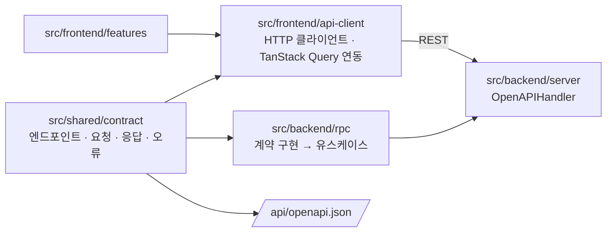

# ADR-007: 프론트는 틀만 그리는 페이지와 기능 단위 클라이언트 컴포넌트로 만들고, API 는 oRPC 계약 하나에서 정한다

## 📚 Context

- spec-01-04 부터 제품 화면이 생긴다. 정해진 것은 "화면은 HTTP API 로만 자료를 읽고 쓴다"(ADR-001 §4) 하나였다.
- 사용자 요청 (2026-11-17): React 와 Next.js 의 최신 흐름으로 라우터, 상태 관리, HTTP 처리, 테스트를 구성한다. 엔드포인트와 요청·응답을 한곳에서 관리하고 HTTP 클라이언트를 둔다. UI 일관성은 Radix 기반 부품과 lint 로 지킨다. 테마는 한곳에서 바꾼다.
- 이 판의 Next.js(16.4)는 Cache Components 가 켜져 있다. 페이지가 요청 시점의 자료를 기다리면 틀(static shell)을 미리 그리지 못한다.
- 이후 화면에는 공통으로 풀 것이 있다: 수집 진행 상황의 주기적 조회, 한 번뿐인 글쓰기, 글쓴이와 출처 종류의 표시.

판과 사용법은 2026-11-17 에 공식 문서와 설치한 패키지의 타입으로 확인했다 (§확인).

## 🎯 Decision

### 1. 라우터

- Next.js App Router 의 파일 라우팅. `src/app/` 에는 `page`, `layout`, `loading`, `error`, `not-found` 만 둔다 (API 는 별도 서버, ADR-009).
- **페이지와 레이아웃은 자료를 읽지 않는 서버 컴포넌트(틀)다.** 주소의 값(`bookId` 등)은 클라이언트 컴포넌트가 `useParams()` 로 읽는다. 자료는 `src/frontend/features/` 의 클라이언트 컴포넌트가 HTTP API 로 가져온다. 서버 컴포넌트에서 유스케이스나 조립(`@/backend`)을 부르지 않는다.
- `typedRoutes: true`. 없는 주소로 링크를 걸면 타입 오류다.
- 주소에 남길 화면 상태(검색어, 탭, 모임 단계)는 **nuqs**(2.x)로 URL 검색 매개변수에 둔다.
- 주소 체계: `/` 책 목록, `/books/new`, `/books/{bookId}`, 모임은 `/sessions/{sessionId}/{단계}` (spec-01-07 부터).

### 2. 상태 관리

| 상태 | 도구 |
|---|---|
| 서버 자료 | **TanStack Query** 5 |
| 주소에 남길 상태 | **nuqs** |
| 입력 양식 | **React Hook Form** + `zod` (shadcn/ui 의 `Field` 부품과 `Controller`) |
| 컴포넌트 안 | `useState`, `useReducer` |
| 여러 화면이 함께 쓰는 클라이언트 상태 | **Zustand**. 위 넷으로 안 되는 상태가 실제로 생길 때만 넣는다 |

전역 상태 저장소는 기본으로 두지 않는다.

### 3. HTTP: 계약, 서버, 클라이언트

- **계약** (`src/shared/contract/`): **oRPC 1.x** 의 계약 우선 방식. 엔드포인트(메서드, REST 주소), 요청과 응답(`zod` 4), 오류 코드를 기능별 파일에 정의하고 `index.ts` 가 모은다. 엔드포인트와 요청·응답의 유일한 원본이다. React 와 Next.js 를 가져오지 않는다.
- **서버** (`src/backend/rpc/`): `implement(contract)` 로 계약을 구현한다. 각 처리는 문맥(context)으로 받은 저장소를 유스케이스에 넘기기만 한다. API 서버(`src/backend/server/`)가 `OpenAPIHandler` 로 처리한다 (ADR-009). REST 주소(`/api/books`)로 열리므로 이후 모바일 클라이언트도 같은 API 를 쓴다.
- **OpenAPI 문서**: 계약에서 엔드포인트 문서(주소 /api/openapi.json)를 만든다. 테스트에서 스냅샷으로 비교해, 계약이 바뀌면 리뷰에 드러나게 한다.
- **HTTP 클라이언트** (`src/frontend/api-client/`): 화면이 서버를 부르는 유일한 통로. `OpenAPILink` 클라이언트 인스턴스 하나에 기본 주소와 공통 헤더를 두고, 요청마다 시간 제한을 걸며, 네트워크 오류·시간 초과·서버 오류·응답 모양 불일치를 모두 `ApiError`(코드, 메시지)로 정규화한다. 화면은 오류 코드로만 분기한다. TanStack Query 연동(`queryOptions`, `mutationOptions`, `key`)을 함께 내보낸다. 읽기 재시도는 TanStack Query 가 맡고 쓰기는 재시도하지 않는다.
- **Server Actions 는 쓰지 않는다.** ADR-001 §4 와 성공 기준 5("API 에서도 나오지 않는다")를 유지한다.
- 서버가 바깥 웹 페이지를 여는 HTTP 요청은 이 클라이언트와 섞지 않는다. 인프라의 `PageFetcher` 로 따로 둔다 (spec-01-08).

### 4. UI

- 스타일은 **Tailwind CSS 4** 만 쓴다 (CSS 모듈, CSS-in-JS 없음).
- 공통 부품은 **shadcn/ui**(Radix UI 기반)로 만들어 `src/frontend/ui/` 에 둔다. 코드는 우리가 소유한다. 이 spec 에 필요한 부품만 추가한다.
- **테마는 한곳에서 바꾼다.** 색, 둥글기, 글꼴의 값은 `src/app/globals.css` 의 CSS 변수(토큰)에서만 정하고, `@theme inline` 으로 Tailwind 에 연결한다. 부품과 화면은 토큰 이름(`bg-primary`, `text-muted-foreground`)만 쓴다. 다크 모드나 다른 테마는 같은 토큰 이름에 다른 값을 주는 묶음(`.dark`)으로 붙인다.
- **`@shadcn/lint`** 로 강제한다: `no-raw-colors`(팔레트 색 직접 사용), `no-arbitrary-values`(눈금 밖 값), `no-unknown-classes`, `no-restyle`(공통 부품의 겉모양 덮어쓰기, `src/frontend/ui/` 안에서는 끈다).
- 글꼴은 시스템 글꼴을 쓴다 (한국어 화면).

### 5. 화면의 공통 규칙 (처음 쓰는 spec 에서 만든다)

- **글쓰기** (spec-01-07): 쓰는 중인 글은 브라우저(`localStorage`)에 자동으로 임시 저장하고, 저장하지 않은 글이 있으면 떠날 때 묻는다. 저장하면 임시본을 지운다. 공통 훅 하나로 만든다. 서버 임시 저장은 하지 않는다 (ADR-005 의 원본 규칙과 섞이므로).
- **글쓴이와 출처의 표시** (spec-01-09): 글 묶음마다 "내가 씀" / "AI 가 씀" / 외부 사람(이름과 매체)을 붙이는 공통 컴포넌트 하나. 외부 인용에는 출처 종류(직접 인용 / 정리 / 재인용)와 원문 주소. 셋은 바탕색 토큰으로도 구분한다.

### 6. 폴더

| 폴더 | 내용 |
|---|---|
| `src/app/` | 화면 라우트 (틀만), `globals.css` |
| `src/frontend/features/{기능}` | 기능 컴포넌트, 훅, 양식. 기능끼리는 서로 가져오지 않는다 |
| `src/frontend/ui/` | shadcn/ui 공통 부품과 `cn` 같은 작은 도우미 |
| `src/shared/contract/`, `src/frontend/api-client/` | 계약, HTTP 클라이언트 |
| `src/backend/rpc/` | 계약 구현 (서버) |

### 7. 의존 규칙 (lint 로 강제, `src/architecture.test.ts` 로 확인)

| 위치 | 가져올 수 없는 것 |
|---|---|
| `src/frontend/**` | `@/backend/**`, `postgres` (ADR-008) |
| `src/app/**` | `@/backend/**`, `postgres` (ADR-008, ADR-009) |
| `src/shared/contract/**` | `react`, `next` |
| `src/frontend/features/**`, `src/frontend/ui/**` | 전역 `fetch` (HTTP 클라이언트를 거친다) |

### 8. 테스트

| 층 | 도구 | 무엇을 |
|---|---|---|
| 도메인, 유스케이스, 저장소 계약 | Vitest (Node) + 메모리 저장소 | 규칙과 흐름 (ADR-006) |
| API 처리 | Vitest (Node). 구현한 라우터를 메모리 저장소 문맥으로 직접 부른다 (`createRouterClient`) | 입력 검사, 오류 코드, 노출 규칙 |
| HTTP 클라이언트 | Vitest (Node). `fetch` 를 바꿔 끼운다 | 오류 정규화, 시간 제한 |
| 컴포넌트 | **Vitest 5 브라우저 모드**(Playwright Chromium) + `vitest-browser-react`. HTTP 는 **MSW** 로 흉내 낸다 | 화면 동작. 접근성 이름(역할, 레이블)으로 찾는다 |
| 흐름 (E2E) | **Playwright**. compose 로 띄운 실제 앱과 DB (`pnpm test:e2e`) | 핵심 흐름 |

페이지(틀)는 따로 테스트하지 않는다. Storybook 은 공통 부품이 늘면 넣는다.

### 9. 기타

- **React Compiler**: `reactCompiler: true`. `useMemo`, `useCallback` 을 손으로 쓰지 않는다. Rust 판(experimental)은 쓰지 않는다.

## 📊 Consequences

- **긍정**: 엔드포인트와 요청·응답이 계약 한 곳에서 나와 서버, 클라이언트, 문서가 어긋나지 않는다.
- **긍정**: 페이지가 자료를 기다리지 않아 틀이 바로 그려지고, Cache Components 와 부딪히지 않는다.
- **긍정**: 테마 값 하나를 바꾸면 모든 화면이 바뀌고, 토큰을 우회한 코드는 lint 가 막는다.
- **긍정**: 컴포넌트를 실제 브라우저에서 테스트하고, 핵심 흐름은 E2E 로 확인한다.
- **부정**: 의존성이 한 번에 많이 늘어난다 (oRPC 7개 패키지, TanStack Query, nuqs, React Hook Form, shadcn/ui 와 Radix, MSW, Playwright, `@shadcn/lint`). 판 올림 부담이 생긴다.
- **부정**: 서버 컴포넌트에서 자료를 미리 그리는 이점(첫 화면에 자료가 바로 보임)을 포기한다. 자료 영역은 잠깐 불러오는 중으로 보인다.
- **부정**: oRPC 는 tRPC 보다 덜 알려져 있고, 공식 문서가 2.0 베타 기준이라 1.x 사용법은 패키지의 타입으로 확인해야 한다. 2.0 정식판이 나오면 판 올림이 필요하다.
- **부정**: `@shadcn/lint` 는 0.2 대의 초기 판이다.
- **중립**: 화면 테스트에 Chromium 이 필요하다 (`playwright install chromium`).

## 🔀 Alternatives

- **Server Actions 와 서버 컴포넌트에서의 직접 조회**: 최근 흐름이고 코드가 적다 — 비채택 이유: ADR-001 §4 와 모바일 가정, 성공 기준 5 의 API 검증과 맞지 않는다.
- **tRPC**: 가장 널리 쓰인다 — 비채택 이유: REST 주소와 OpenAPI 문서가 기본이 아니라 다른 클라이언트에 불리하다.
- **route 파일 + `zod` + 손으로 만든 HTTP 클라이언트**: 의존성이 적다 — 비채택 이유: OpenAPI 문서, 타입 있는 오류, TanStack Query 키를 손으로 맞춰야 한다.
- **SWR**: 가볍다 — 비채택 이유: 쓰기(mutation)와 무효화 지원이 TanStack Query 보다 약하고 oRPC 연동이 TanStack Query 쪽에 있다.
- **Zustand 를 지금 넣기**: 흔한 조합이다 — 비채택 이유: 지금 보이는 상태는 서버 자료와 주소 상태뿐이다.
- **Radix Themes**: 완성된 테마 — 비채택 이유: 자체 스타일 체계라 Tailwind 와 겹친다.
- **jsdom 기반 컴포넌트 테스트**: 빠르다 — 비채택 이유: 실제 브라우저 동작과 다를 수 있고, Vitest 문서가 브라우저 모드를 권한다.
- **Feature-Sliced Design 전체 계층**: 경계가 엄격하다 — 비채택 이유: 이 규모에 과하다. 기능 폴더와 의존 규칙만 가져온다.

## 📌 Status

고침 (2026-11-17): API 의 입구는 Next.js route 파일이 아니라 별도 API 서버(`src/backend/server/`)다. 브라우저는 같은 주소의 `/api` 를 부르고 Next.js 가 rewrites 로 넘긴다 (ADR-009). 화면 쪽 규칙은 바뀌지 않는다.

경로 고침 (2026-11-17): 화면 코드는 `src/frontend/`, 계약은 `src/shared/contract/`, 계약 구현은 `src/backend/rpc/` 로 옮겼다 (ADR-008). HTTP 클라이언트 폴더 이름은 `api-client` 다.

Accepted (2026-11-17, spec-01-04, 사용자 요청과 Plan Accept). 첫 적용: 책 등록.

### 확인 (2026-11-17)

| 항목 | 판 | 확인한 곳 |
|---|---|---|
| Next.js `typedRoutes`, `reactCompiler` stable, Rust 판 experimental | 16.4.6 | 번들 문서 (`node_modules/next/dist/docs/`) |
| oRPC 계약, `implement`, `OpenAPIHandler`, `OpenAPILink`, TanStack Query 연동, `OpenAPIGenerator` | 1.16.2 (안정판). 공식 문서는 2.0.0-beta.50 기준 | orpc.dev 문서와 설치한 패키지의 타입. 1.x 에서 Zod 4 변환기는 `@orpc/zod/zod4`, `OpenAPILink` 는 `@orpc/openapi-client/fetch` |
| Vitest 브라우저 모드 | 5.1.0 | vitest.dev. React 는 `vitest-browser-react` 를 권한다 |
| MSW | 3.0.6 | mswjs.io (Vitest 브라우저 모드 recipe) |
| nuqs | 2.10.3 | nuqs.dev. Next.js 16 과 Cache Components 호환은 문서에 없다. 빌드로 확인한다 |
| shadcn/ui | CLI 최신 | ui.shadcn.com (`init --base radix`, `aliases.ui`, `@theme inline`, `Field` 양식) |
| `@shadcn/lint` | 0.2.5 | github.com/shadcn-ui/lint (React 설정, Tailwind 4) |

## 🔗 Related

- ADR-001 §4, ADR-006
- `docs/architecture.md` §6
- spec-01-04
