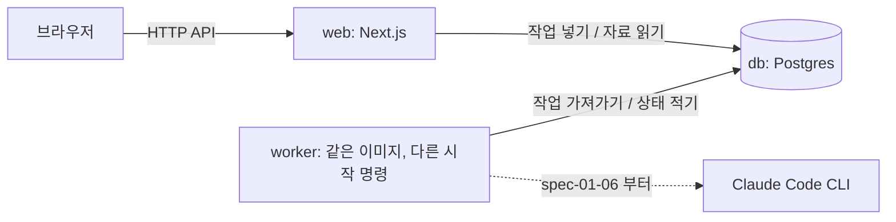

# spec-01-03: 프로젝트 뼈대와 로컬 환경

## 📋 메타

| 항목 | 값 |
|---|---|
| **Spec ID** | `spec-01-03` |
| **Phase** | `phase-01` |
| **Branch** | `spec-01-03-project-skeleton` |
| **Base 브랜치** | `main` |
| **상태** | Planning |
| **타입** | Feature |
| **작성일** | 2026-11-17 |
| **소유자** | Changsik00 |

## 배경 및 문제 정의

### 현재 상황

ADR-001 ~ 005 가 병합됐다. 저장소에는 문서만 있고, 워킹트리에 커밋하지 않은 Next.js 16 뼈대가 있다 (기본 화면 그대로, `@anthropic-ai/sdk` 포함). docker 설정, DB, 테스트 실행기는 없다. 이 기기에는 Docker 29, Node 22, pnpm 9, Claude Code CLI 2.1 이 설치되어 있다.

### 문제점

- ADR-004 는 네 가지 가정 위에 서 있고, 문서로만 확인했다. 틀린 가정이 있으면 이후 spec 의 구조가 달라진다.
- 이후 spec 이 올라설 실행 환경, DB, 작업 프로세스, 테스트 명령이 없다.

### 해결 방안

뼈대를 정리해 커밋한 직후 ADR-004 의 가정 네 가지를 컨테이너에서 실제로 돌려 확인한다. 통과하면 `docker compose up` 으로 웹 앱, 작업 프로세스, DB 가 뜨고 빈 작업 하나가 처리되는 데까지 만든다. 제품 기능은 만들지 않는다.

## 요구사항

1. **가정 확인**: ADR-004 "검증이 필요한 가정" 네 가지를 컨테이너 안에서 실행하고 결과를 기록한다. 하나라도 틀리면 멈추고 사용자에게 보고한다 (ADR 수정이 먼저다).
2. `docker compose up` 한 번으로 웹 앱, 작업 프로세스, DB 가 뜬다. 재시작 뒤에도 DB 자료가 남는다 (phase-01 성공 기준 6).
3. 웹 앱에 상태 확인 HTTP API 가 있고, DB 연결 여부를 돌려준다.
4. DB 구조는 마이그레이션 파일로 관리한다. 첫 마이그레이션은 사용자와 작업 대기열 테이블을 만들고 로컬 사용자 한 명을 넣는다 (ADR-003).
5. 작업 프로세스가 대기열에서 작업을 가져가 처리하고 상태(대기 / 진행 중 / 끝남 / 실패)를 적는다. 두 프로세스가 같은 작업을 동시에 가져가지 않는다. 이 spec 에서는 아무 일도 하지 않는 시험용 작업 하나만 처리한다 (ADR-001).
6. 테스트, lint, 타입 검사가 각각 한 명령으로 돌고 `sdd config precheck` 에 등록된다.
7. 비밀값(CLI 토큰, DB 비밀번호)은 커밋되지 않는다. 필요한 변수의 이름만 예시 파일에 적는다.
8. `README.md` 에 프로젝트 소개와 실행 방법을 한국어로 적는다 (phase-FF 예정 항목을 여기서 처리).

## Out of Scope

- 책, 모임, 내 해석 등 제품 자료의 테이블과 화면 (spec-01-04 부터)
- LLM 호출 경계 모듈과 수집 절차 (spec-01-06). 이 spec 의 가정 확인은 일회성 스크립트다
- 인증, 배포, 운영용 빌드. compose 는 개발 모드로 띄운다
- CI 설정
- 화면 디자인. 첫 화면은 제품 이름과 상태 확인 결과만 보여준다

## 🛑 사용자 검토 필요

> [!IMPORTANT]
> - [ ] **사용자가 직접 해야 하는 일이 하나 있다.** Task 3(가정 확인) 전에 터미널에서 `claude setup-token` 을 실행해 토큰을 받고, 저장소 루트의 `.env` 파일에 `CLAUDE_CODE_OAUTH_TOKEN=<토큰>` 한 줄을 적는다. 브라우저 승인이 필요해 에이전트가 대신할 수 없다. `.env` 는 gitignore 되어 있다. 에이전트는 이 파일의 내용을 읽거나 출력하지 않는다.
> - [ ] **가정 확인은 구독 사용량을 쓴다.** 검색 한두 번과 짧은 호출 몇 번이다.
> - [ ] **ORM 을 쓰지 않는다.** 이미 들어 있는 `postgres` 라이브러리로 SQL 을 직접 쓰고, 읽어 온 행은 `zod` 로 검사한다. 마이그레이션은 번호가 붙은 SQL 파일과 작은 실행 스크립트로 한다. 대안은 Drizzle ORM 이다.
> - [ ] **테스트 실행기는 Vitest.** DB 가 필요한 테스트는 compose 의 Postgres 에 시험용 데이터베이스를 따로 만들어 쓴다.
> - [ ] **통합 시나리오 2 의 문구를 고친다.** PR #2 에서 물었던 항목이다. 답이 없어 권장안으로 진행한다: "내 해석 저장 전에는 LLM 호출도 일어나지 않는다"를 "독자 단위 작업(연결, 비교)은 만들어지지 않고, 책 단위 수집 결과는 내주지 않는다"로 바꾼다. 미리 수집을 포기하는 쪽을 원하면 알려 달라.

> [!WARNING]
> - [ ] 워킹트리의 미커밋 뼈대 파일을 고쳐서 커밋한다. 기본 화면(`src/app/page.tsx`), 기본 `README.md`, `public/` 의 예시 그림은 교체하거나 지운다. `@anthropic-ai/sdk` 는 뺀다.
> - [ ] `AGENTS.md` 는 Next.js 가 만들어 다시 써 넣는 파일이라 그대로 커밋한다. 이 파일은 "이 판의 Next.js 는 알던 것과 다르니 `node_modules` 안의 문서를 먼저 읽으라"고 적고 있다. 코드를 쓰기 전에 해당 문서를 읽는다.

## 핵심 전략



| 컴포넌트 | 전략 | 이유 |
|:---:|:---|:---|
| **가정 확인** | `scripts/spike/` 의 일회성 스크립트를 작업 프로세스와 같은 이미지에서 실행. 결과는 `docs/experiments/02-cli-assumptions/` 에 기록 | 실제 실행 환경에서 확인해야 의미가 있다. 스크립트는 기록으로 남기되 제품 코드가 쓰지 않는다 |
| **이미지** | 이미지 하나 (Node 22, pnpm, Claude Code CLI). compose 가 `web` 과 `worker` 를 시작 명령만 달리해 띄운다 | ADR-001 §2 |
| **DB 접근** | `src/db/` 에 연결과 마이그레이션, `src/domain/` 에 자료를 읽고 쓰는 함수. HTTP API 와 작업 프로세스는 `src/domain/` 만 부른다 | ADR-001 §4 |
| **대기열** | `jobs` 테이블. 가져갈 때 `FOR UPDATE SKIP LOCKED` 로 한 프로세스만 잡는다 | ADR-001 §3 |
| **작업 프로세스** | `src/worker/` 의 진입점을 `tsx` 로 실행. 주기적으로 대기열을 본다. 작업 종류별 처리기를 등록하는 구조 | 이후 spec 이 처리기를 추가하기만 하면 된다 |
| **사용자** | `src/domain/` 에 "지금 사용자"를 돌려주는 함수 하나. 지금은 미리 넣은 로컬 사용자 | ADR-003 §4 |
| **테스트** | Vitest. 순수 로직은 단위 테스트, DB 를 쓰는 것은 시험용 데이터베이스에서 실제 SQL 로 | 대기열의 동시성은 실제 DB 에서만 확인된다 |

## Proposed Changes

#### [NEW] 뼈대 (워킹트리에 있던 파일을 정리해 커밋)
`package.json`, `pnpm-lock.yaml`, `tsconfig.json`, `next.config.ts`, `eslint.config.mjs`, `AGENTS.md`, `src/app/layout.tsx`, `src/app/globals.css`, `src/app/favicon.ico`. `@anthropic-ai/sdk` 제거. `test`, `typecheck` 스크립트와 Vitest, `tsx` 추가.

#### [NEW] `src/app/page.tsx`
제품 이름과 상태 확인 결과만 보여주는 첫 화면. 기본 화면과 `public/` 의 예시 그림은 지운다.

#### [NEW] `scripts/spike/`, `docs/experiments/02-cli-assumptions/README.md`
가정 네 가지를 확인하는 스크립트와 결과 기록.

#### [NEW] `Dockerfile`, `compose.yaml`, `.dockerignore`, `.env.example`
이미지와 세 컨테이너. DB 는 이름 붙은 볼륨을 쓴다.

#### [MODIFY] `.gitignore`
`.env.example` 은 커밋되도록 예외를 둔다.

#### [NEW] `src/db/`
연결, 마이그레이션 실행 스크립트, `migrations/0001_init.sql` (사용자, 작업 대기열, 로컬 사용자).

#### [NEW] `src/domain/`
"지금 사용자", 작업 넣기 / 가져가기 / 끝내기 / 실패 기록.

#### [NEW] `src/worker/`
진입점과 시험용 작업 처리기.

#### [NEW] `src/app/api/health/route.ts`
상태 확인 HTTP API.

#### [NEW] 테스트
`src/**/*.test.ts`, `vitest.config.ts`.

#### [MODIFY] `README.md`
프로젝트 소개와 실행 방법 (한국어).

#### [MODIFY] `docs/decisions/ADR-001 ~ 005`, `docs/decisions/README.md`
상태를 `accepted` 로 (PR #2 병합됨). 가정 확인 결과를 ADR-004 에 반영.

#### [MODIFY] `backlog/phase-01.md`
통합 시나리오 2 의 문구, 통합 테스트 실행 명령, phase-FF 의 README 항목 완료 표시.

## 검증 계획

```bash
pnpm lint
pnpm typecheck
pnpm test
docker compose up -d --wait
curl -s localhost:3000/api/health
```

수동 검증 시나리오:
1. `docker compose up -d --wait` — 기대 결과: 세 컨테이너가 뜨고 `/api/health` 가 DB 연결됨을 돌려준다.
2. 시험용 작업을 하나 넣는다 — 기대 결과: 몇 초 안에 작업 프로세스가 가져가 "끝남"으로 바뀐다.
3. `docker compose down` 뒤 다시 `up` — 기대 결과: 로컬 사용자와 끝난 작업 기록이 남아 있다.
4. `git status` 와 `git log -p` 에서 토큰이나 비밀번호가 보이지 않는다.

## 롤백 계획

- 코드와 설정은 `git revert`.
- DB 볼륨은 `docker compose down -v` 로 지운다. 이 spec 시점에는 지켜야 할 자료가 없다.
- 발급한 CLI 토큰은 `.env` 에서 지운다. 토큰을 서버 쪽에서 무효화하는 방법은 문서에서 확인하지 못했다.

## ADR 후보

- [ ] ADR 가치 있는 결정 있음
- [x] 없음. ORM 미사용과 Vitest 는 ADR-001 이 이 spec 에 맡긴 선택이며 `walkthrough.md` 에 적는다. 가정 확인에서 틀린 것이 나오면 ADR-004 를 대체하는 새 ADR 을 쓴다.

## ✅ Definition of Done

- [ ] ADR-004 의 가정 네 가지 확인 결과가 기록되어 있음
- [ ] 모든 테스트 PASS, lint 와 타입 검사 통과
- [ ] `docker compose up` 으로 세 컨테이너가 뜨고 시험용 작업이 처리됨
- [ ] precheck 등록
- [ ] `walkthrough.md` 와 `pr_description.md` 작성 및 ship commit
- [ ] `spec-01-03-project-skeleton` 브랜치 push 완료
