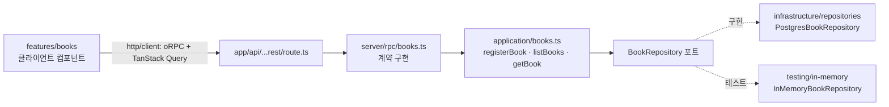

# spec-01-04: 프론트 구조와 책 등록

## 📋 메타

| 항목 | 값 |
|---|---|
| **Spec ID** | `spec-01-04` |
| **Phase** | `phase-01` |
| **Branch** | `spec-01-04-book-registration` |
| **Base 브랜치** | `main` |
| **상태** | Planning |
| **타입** | Feature |
| **작성일** | 2026-11-17 |
| **소유자** | Changsik00 |

## 배경 및 문제 정의

### 현재 상황

서버는 세 계층과 저장소 구조로 정리됐다 (ADR-006). 화면은 제품 이름과 DB 상태를 보여주는 첫 화면 하나뿐이다. 프론트에 대해 정해진 것은 "화면은 HTTP API 로만 자료를 읽고 쓴다"(ADR-001 §4) 하나다. 사용자는 화면을 만들기 전에 프론트 구조를 설계하기를 요청했다 (`backlog/phase-01.md` spec-01-04).

### 문제점

- 이 spec 부터 제품 화면이 생긴다. 구조 없이 만들면 화면마다 자료를 가져오는 방식, 폴더, 오류 처리가 달라진다.
- 이후 spec 의 화면에는 공통으로 풀어야 할 것이 있다. 수집 진행 상황의 주기적 조회(spec-01-06 ~ 08), 한 번뿐인 글쓰기(spec-01-05), 글쓴이와 출처 종류의 표시(spec-01-07, 08).
- 이 판의 Next.js 는 Cache Components 가 켜져 있어, 서버 컴포넌트에서 요청 시점의 자료를 읽는 방식에 제약이 있다 (번들 문서 `02-guides/migrating-to-cache-components.md`).

### 해결 방안

먼저 ADR-007 로 프론트 구조를 정하고, 그 구조로 첫 기능인 책 등록(서버부터 화면까지)을 만든다. 책 등록이 구조의 첫 사례가 된다.

## 요구사항

### 프론트 구조

1. ADR-007 을 쓴다. `backlog/phase-01.md` 가 정한 일곱 항목에 선택지와 이유를 단다 (아래 §핵심 전략).
2. 의존 규칙을 lint 로 막고 `src/architecture.test.ts` 에 사례를 더한다. 화면 코드는 조립, 애플리케이션, 인프라, 도메인을 가져오지 않는다.
3. `docs/architecture.md` §6 프론트를 채운다.
4. **테마는 한곳에서 바꾼다** (사용자 요청, 2026-11-17). 색, 둥글기, 글꼴은 `src/app/globals.css` 의 토큰(CSS 변수)에서만 값을 정한다. 부품과 화면은 토큰 이름(`bg-primary`, `text-muted-foreground`, `rounded-lg` 등)만 쓴다. 토큰 값 하나를 바꾸면 모든 화면이 함께 바뀐다. 다크 모드나 다른 테마는 같은 토큰 이름에 다른 값을 주는 묶음(`.dark` 등)을 더하는 것으로 붙일 수 있게 둔다 (이 spec 에서는 밝은 테마 하나만 만든다).

### 책 등록

5. 제목과 작가를 직접 입력해 책을 등록한다. 앞뒤 공백은 지우고, 제목 1~200자, 작가 1~100자다.
6. 장르는 책의 속성이다 (ADR-002 §4). 지금은 소설 하나뿐이며 화면에서 고르지 않고 "소설"로 보여준다.
7. 같은 책은 두 번 등록되지 않는다. 제목과 작가를 정규화(앞뒤 공백 제거, 연속 공백 하나로, 대소문자 무시)해 같으면 같은 책이다. 이미 있으면 새로 만들지 않고 기존 책을 알려준다. 책 단위 자료를 재사용하기 위해서다 (ADR-002 §1).
8. 등록한 책 목록과 책 한 권의 정보를 볼 수 있다. 책은 공유 자료라 사용자 식별자가 없다 (ADR-003 §2).
9. HTTP API: oRPC 계약으로 정의하고 REST 주소로 연다 (`GET /api/books`, `POST /api/books`, `GET /api/books/{bookId}`). 서버와 화면이 같은 계약을 쓴다. 오류는 타입 있는 코드로 돌려준다.
10. 화면: 책 목록(`/`), 책 등록(`/books/new`), 책 정보(`/books/{bookId}`). 책 정보 화면의 "모임 시작"은 spec-01-05 전까지 눌리지 않는다.

## Out of Scope

- 모임, 내 해석 (spec-01-05). 임시 저장과 이탈 방지는 ADR-007 에서 규칙만 정하고 spec-01-05 에서 만든다
- 글쓴이와 출처 종류의 표시 컴포넌트. ADR-007 에서 규칙만 정하고 처음 쓰는 spec(spec-01-07)에서 만든다
- 책 정보 고치기와 지우기, 표지 그림, 외부 도서 검색 (Icebox)
- Storybook, Zustand (필요해질 때)
- 토큰 값의 디자인 다듬기와 다크 모드. 이 spec 은 shadcn/ui 기본 토큰에서 시작하고 이름 체계만 정한다

## 🛑 사용자 검토 필요

> [!IMPORTANT]
> - [ ] **프론트 구조 (ADR-007, 최신 흐름 반영)**: 아래 §핵심 전략. 지금 넣는 것은 nuqs, TanStack Query, React Hook Form, oRPC, React Compiler, `typedRoutes`, Vitest 4 브라우저 모드, MSW, Playwright, shadcn/ui(Radix UI), `@shadcn/lint`. 넣지 않는 것은 Zustand, Storybook.
> - [ ] **Server Actions 를 쓰지 않는다.** 최근 흐름과 다르지만 ADR-001 의 "화면은 HTTP API 로만"을 유지한다.
> - [ ] **oRPC 는 tRPC 보다 덜 알려져 있다.** 고른 이유는 REST 주소와 OpenAPI 를 함께 낼 수 있다는 점이다. 의존이 큰 선택이라 Task 3 에서 공식 문서로 확인하고, 맞지 않으면 멈추고 보고한다.
> - [ ] **같은 책 판정**: 제목과 작가가 정규화 뒤 같으면 같은 책이다. 번역본과 판본은 구분하지 않는다.
> - [ ] **테마는 한곳에서**: 색, 둥글기, 글꼴은 `globals.css` 토큰으로만. 기본 뼈대의 Geist 를 빼고 시스템 글꼴을 쓴다.

> [!WARNING]
> - [ ] 의존성이 한 번에 많이 늘어난다. 이 spec 의 Task 3 이 길어지고, 이후 판 올림 부담이 생긴다.
> - [ ] Playwright E2E 는 compose 로 띄운 앱이 있어야 돈다. `pnpm test` 와 따로 `pnpm test:e2e` 로 둔다.

## 핵심 전략

### ADR-007 프론트 구조의 제안 (최신 흐름 반영, 2026-11-17)

사용자 요청: React 와 Next.js 의 최신 흐름으로 라우터, 전역 상태, HTTP 처리, 테스트를 구성한다. 2026-11 기준 자료(공식 문서와 블로그)를 확인했고, 혼자 만드는 규모에 맞춰 **지금 넣을 것**과 **필요해질 때 넣을 것**을 나눴다.

#### 1. 라우터

| 항목 | 제안 | 이유 |
|---|---|---|
| 라우팅 | Next.js App Router 의 파일 라우팅. `src/app/` 에는 페이지, 레이아웃, `loading.tsx`, `error.tsx`, `not-found.tsx` 만 둔다 | 프레임워크 기본. 화면 코드는 `src/features/` 에 둔다 |
| 주소의 타입 | `typedRoutes: true` (이 판에서 stable). 없는 주소로 `<Link>` 를 걸면 타입 오류 | 주소 오타를 빌드 전에 잡는다 |
| 주소의 상태 | 검색어, 탭, 모임 단계 같은 화면 상태는 **nuqs** 로 URL 검색 매개변수에 둔다 (타입 있는 `useQueryState`) | 새로고침과 뒤로 가기, 링크 공유에 상태가 남는다. 전역 상태 라이브러리가 맡던 일의 상당 부분을 대신한다 |
| 모임 단계 | `/sessions/{id}/{단계}` 처럼 단계마다 주소 (spec-01-05 부터) | 위와 같음 |
| 서버·클라이언트 경계 | 페이지와 레이아웃은 자료를 읽지 않는 서버 컴포넌트(틀). 자료는 `src/features/` 의 클라이언트 컴포넌트가 HTTP API 로 가져온다. 서버 컴포넌트에서 유스케이스를 직접 부르지 않는다 | ADR-001 §4. Cache Components 에서 틀이 바로 그려진다 |

#### 2. 상태 관리

상태를 종류별로 나눠 각각 맞는 도구에 맡기고, "전역 상태 저장소"는 기본으로 두지 않는다.

| 상태의 종류 | 도구 | 지금 |
|---|---|:---:|
| 서버 자료 (책, 모임, 수집 진행 상황) | **TanStack Query**. 주기적 조회, 쓰기 뒤 무효화, 중복 요청 제거 | 넣음 |
| 주소에 남길 화면 상태 | **nuqs** | 넣음 |
| 입력 양식 | **React Hook Form** + `zod` (shadcn/ui 의 양식 부품과 연결) | 넣음 |
| 컴포넌트 안의 상태 | `useState`, `useReducer` | - |
| 여러 화면이 함께 쓰는 클라이언트 상태 | **Zustand**. 위 넷으로 안 되는 상태가 실제로 생길 때 넣는다 | 넣지 않음 |

자료들은 TanStack Query + Zustand(또는 Jotai) 조합을 2026년의 흔한 기본으로 꼽는다. 이 제품에서 지금 보이는 상태는 거의 서버 자료와 주소 상태라 Zustand 는 규칙만 정해 둔다.

#### 3. HTTP 처리

| 항목 | 제안 | 이유 |
|---|---|---|
| API 정의 | **oRPC** 의 계약 우선 방식. 요청과 응답을 `zod` 스키마로 `src/http/contract/` 에 정의한다 | 서버와 화면이 같은 계약을 쓰고 타입이 끝까지 이어진다. tRPC 와 달리 계약을 **REST 주소와 OpenAPI 문서로 열 수 있어** 이후 모바일 클라이언트가 같은 API 를 쓸 수 있다 (ADR-001 의 모바일 가정) |
| 서버 쪽 | `src/server/rpc/` 가 계약을 구현한다. 각 처리는 조립(container)에서 저장소를 받아 유스케이스를 부르기만 한다. Next.js 에는 route 파일 하나(`src/app/api/[...rest]/route.ts`)로 붙인다. `/api/health` 는 그대로 | 진입점이 얇다. 처리 함수를 메모리 저장소로 직접 불러 테스트한다 |
| 화면 쪽 | oRPC 클라이언트 + TanStack Query 연동(`queryOptions`, `mutationOptions`). 쿼리 키를 손으로 쓰지 않는다 | 키 관리와 무효화 실수를 줄인다 |
| 오류 | oRPC 의 타입 있는 오류(`NOT_FOUND`, `CONFLICT`, `BAD_REQUEST` 와 이유). 화면은 오류 코드로 분기한다 | 오류 모양이 한 가지다 |
| Server Actions | **쓰지 않는다** | 최근 흐름은 Server Actions 와 서버 컴포넌트에서의 직접 조회가 많지만, ADR-001 이 "화면은 HTTP API 로만"을 정했다. 모바일 가정, 성공 기준 5 의 "API 에서도 나오지 않는다" 검증과 맞추기 위해 유지한다 |

**엔드포인트와 요청·응답의 관리** (사용자 질문, 2026-11-17)

| 무엇 | 어디서 한 번만 정하나 | 강제하는 방법 |
|---|---|---|
| 엔드포인트 목록 (주소, 메서드) | `src/http/contract/index.ts` 의 계약 묶음. 기능별 파일(`books.ts`)을 모은다 | 계약에 없는 주소는 서버가 처리하지 않는다 |
| 요청과 응답의 모양 | 같은 계약 안의 `zod` 스키마 | 서버는 들어오는 요청을, 클라이언트는 받은 응답을 같은 스키마로 검사한다 |
| 오류의 종류 | 계약에 선언한 오류 코드와 그 데이터 | 선언하지 않은 오류는 `INTERNAL` 하나로 묶인다 |
| 엔드포인트 문서 | 계약에서 만든 OpenAPI 문서(`/api/openapi.json`) | 문서를 테스트에서 스냅샷으로 비교해, 계약이 바뀌면 리뷰에 드러나게 한다 |

**HTTP 클라이언트** (`src/http/client/`): 화면이 서버를 부르는 유일한 통로다. 손으로 만드는 httpclient 가 하던 일을 여기서 한다.

| 하는 일 | 방법 |
|---|---|
| 기본 주소, 공통 헤더 | 클라이언트 인스턴스 하나에 설정 (이후 인증 헤더도 여기) |
| 시간 제한, 취소 | 요청마다 시간 제한. TanStack Query 의 취소 신호를 넘긴다 |
| 오류 정규화 | 네트워크 오류, 시간 초과, 서버 오류, 응답 모양 불일치를 모두 `ApiError`(코드, 메시지)로 바꾼다. 화면은 코드로만 분기한다 |
| 재시도 | 읽기는 TanStack Query 가 맡는다 (쓰기는 재시도하지 않는다) |
| 기능별 호출 | `api.books.list()`, `api.books.register(...)` 와 그 `queryOptions` / `mutationOptions` |

화면 코드(`src/features/**`, `src/ui/**`)에서 `fetch` 를 직접 쓰면 lint 가 막는다 (`no-restricted-globals`). 반대 방향, 즉 서버가 바깥 웹 페이지를 여는 HTTP 요청은 화면용 클라이언트와 섞지 않고 인프라의 `PageFetcher` 로 따로 둔다 (spec-01-06).

대안: (a) 처음 안처럼 route 파일과 `zod` 를 직접 쓰기 — 의존성이 적지만 클라이언트와 쿼리 키를 손으로 맞춘다. (b) tRPC — 가장 널리 쓰이지만 REST 주소가 아니라 모바일 등 다른 클라이언트에 불리하다. (c) Server Actions — ADR-001 을 바꿔야 한다.

#### 4. 테스트

| 층 | 도구 | 무엇을 | 지금 |
|---|---|---|:---:|
| 도메인, 유스케이스, 저장소 계약 | Vitest (Node) + 메모리 저장소 | 규칙과 흐름 (ADR-006) | 있음 |
| API 처리 | Vitest (Node). oRPC 처리 함수를 메모리 저장소로 직접 부른다 | 입력 검사, 오류 코드, 노출 규칙 | 넣음 |
| 컴포넌트 | **Vitest 4 브라우저 모드**(Playwright 의 Chromium) + Testing Library. HTTP 는 **MSW** 로 흉내 낸다 | 화면 동작, 접근성 이름으로 찾기 | 넣음 |
| 흐름 (E2E) | **Playwright**. compose 로 띄운 실제 앱과 DB | 책 등록 흐름 하나. 이후 "먼저 쓰고 그다음 본다" 흐름 | 넣음 |
| 부품 목록, 시각 회귀 | Storybook + Vitest 애드온 | 공통 부품의 모양 | 넣지 않음 (부품이 늘면) |

jsdom 대신 실제 브라우저에서 컴포넌트를 돌리는 것이 Vitest 4 에서 stable 이 됐고, MSW 는 같은 흉내를 Node 와 브라우저에서 함께 쓴다. 처음 안의 "E2E 없음"을 철회하고 Playwright 를 지금 넣는다.

#### 5. 기타

| 항목 | 제안 | 이유 |
|---|---|---|
| React Compiler | `reactCompiler: true` (Next.js 16 에서 stable). `useMemo`, `useCallback` 을 손으로 쓰지 않는다 | 자동 메모이제이션. 빌드가 조금 느려진다. Rust 판은 아직 experimental 이라 쓰지 않는다 |
| 폴더 | `src/app/` 라우트, `src/features/<기능>/` 기능(컴포넌트, 훅, 양식), `src/ui/` 공통 부품(shadcn/ui), `src/http/` 계약과 클라이언트. 서버는 ADR-006 그대로 | 기능 단위로 모은다. Feature-Sliced Design 의 전체 계층은 이 규모에 과하다 |
| UI 일관성 | Tailwind CSS 4 만. shadcn/ui(Radix UI) 부품을 `src/ui/` 에 소유. 색, 둥글기, 글꼴은 `globals.css` 토큰으로만. `@shadcn/lint` 로 강제 | (앞서 합의) |
| 글쓰기 규칙 | 쓰는 중인 글은 브라우저에 자동 임시 저장, 떠날 때 묻기 (spec-01-05) | 독자가 쓰는 유일한 곳 |
| 글쓴이 표시 | "내가 씀 / AI 가 씀 / 외부 사람" 공통 컴포넌트, 출처 종류와 주소, 바탕색 구분 (spec-01-07) | 원칙 "내 글과 AI 글을 섞지 않는다" |

#### 의존 규칙 (lint 로 강제)

| 위치 | 가져올 수 없는 것 |
|---|---|
| `src/features/**`, `src/ui/**`, `src/http/**` | `@/server`, `@/application`, `@/infrastructure`, `@/domain`, `postgres` |
| `src/app/**` (단, `src/app/api/**` 제외) | `@/server`, `@/application`, `@/infrastructure`, `postgres` |
| `src/http/contract/**` | React, Next.js (서버와 화면이 함께 쓰므로) |
| `src/features/**`, `src/ui/**` | 전역 `fetch` 직접 사용 (`src/http/client/` 를 거친다) |

#### 확인한 것과 확인하지 못한 것

- 이 판의 Next.js 번들 문서로 확인: `typedRoutes` stable, `reactCompiler` stable, Rust 판 React Compiler experimental, TanStack Query 연동 방식.
- 블로그와 비교 글로만 확인 (Task 에서 공식 문서로 다시 확인한다): oRPC 의 현재 판과 Next.js 연결 방법, nuqs 의 Next.js 16·Cache Components 호환, Vitest 4 브라우저 모드와 MSW 설정, `@shadcn/lint` 의 React 설정. 하나라도 설명과 다르면 멈추고 보고한다.

### 책 등록의 구조



| 컴포넌트 | 전략 | 이유 |
|:---:|:---|:---|
| **도메인** | `src/domain/book.ts`: 책 타입, 장르(`fiction`), 제목·작가 정규화와 길이 규칙 | 순수한 규칙이라 DB 없이 테스트한다 |
| **유스케이스** | `registerBook` 은 규칙을 검사하고, 같은 책이 있으면 `{ status: "exists", book }`, 없으면 `{ status: "created", book }` 을 돌려준다 | HTTP 는 이 결과를 201 과 409 로 옮기기만 한다 |
| **저장소** | `BookRepository`: `create`, `findById`, `findByKey`(정규화한 제목과 작가), `list`. 메모리 구현과 계약 테스트 | ADR-006 §4 |
| **DB** | `0002_books.sql`: `books` 테이블, 정규화 키에 유일 인덱스. 동시에 같은 책을 등록해도 하나만 생긴다 | 유스케이스의 확인과 쓰기 사이에 끼어드는 요청이 있어도 DB 가 막는다 |
| **HTTP 처리** | `src/http/contract/books.ts` 에 계약, `src/server/rpc/books.ts` 에 구현. 구현은 저장소를 문맥(context)으로 받아 메모리 저장소로 직접 불러 테스트한다. `exists` 는 `CONFLICT` 오류와 기존 책, 없는 책은 `NOT_FOUND` | route 파일은 Next.js 의 규칙에 묶여 있어 직접 테스트하기 어렵다 |
| **화면** | `src/features/books/`: 목록, 등록 양식(React Hook Form), 책 정보. 등록이 끝나면 목록 쿼리를 무효화하고 책 정보로 이동한다. 이미 있는 책이면 그 책으로 가는 안내를 보여준다 | |

## Proposed Changes

#### [NEW] `docs/decisions/ADR-007-frontend-structure.md`, [MODIFY] `docs/decisions/README.md`
#### [MODIFY] `docs/architecture.md`
§6 프론트, §2 포트 표, §4 데이터 표.

#### [NEW] `src/domain/book.ts`, `src/application/books.ts`, [MODIFY] `src/application/ports.ts`
#### [NEW] `src/infrastructure/db/migrations/0002_books.sql`, `src/infrastructure/repositories/postgres-book-repository.ts`
#### [NEW] `src/testing/in-memory/in-memory-book-repository.ts`, `src/testing/contracts/book-repository.contract.ts`
#### [MODIFY] `src/server/container.ts`
#### [NEW] `src/http/client/`
oRPC 클라이언트와 TanStack Query 연동.
#### [NEW] `src/app/providers.tsx`, [MODIFY] `src/app/layout.tsx`, `src/app/page.tsx`, `src/app/globals.css`
TanStack Query 와 nuqs 제공자, 시스템 글꼴, 디자인 토큰(색, 둥글기 등), 첫 화면을 책 목록으로.
#### [NEW] `src/app/books/new/page.tsx`, `src/app/books/[bookId]/page.tsx`
#### [NEW] `src/features/books/`, `src/ui/`
#### [DELETE] `src/app/health-status.tsx`
첫 화면이 책 목록이 되므로 뺀다. `/api/health` 는 그대로 둔다.
#### [MODIFY] `eslint.config.mjs`, `src/architecture.test.ts`, `vitest.config.mts`, `package.json`, `next.config.ts`
화면의 의존 규칙, `@shadcn/lint` 규칙, Vitest 프로젝트 둘(Node, 브라우저), `typedRoutes`, `reactCompiler`, 의존성(TanStack Query, nuqs, React Hook Form, oRPC, shadcn/ui, Radix UI, MSW, Testing Library, Playwright).
#### [NEW] `playwright.config.ts`, `e2e/`
책 등록 흐름 E2E.
#### [NEW] `src/http/contract/`, `src/server/rpc/`, `src/app/api/[...rest]/route.ts`
oRPC 계약, 서버 구현, Next.js 연결.
#### [NEW] `components.json`
shadcn/ui 설정 (부품을 `src/ui/` 에 둔다).
#### [MODIFY] `README.md`, `backlog/phase-01.md`

## 검증 계획

```bash
pnpm lint && pnpm typecheck && pnpm test:unit
docker compose up -d --wait
pnpm test          # Node 와 브라우저 프로젝트
pnpm test:e2e      # Playwright, 실제 앱
pnpm build
```

수동 검증 시나리오:
1. `/` 에서 "책 등록" → 제목과 작가 입력 → 등록 — 기대 결과: 책 정보 화면으로 가고, `/` 목록에 나타난다. 장르는 "소설".
2. 같은 책을 공백과 대소문자만 바꿔 다시 등록 — 기대 결과: 새로 만들어지지 않고 "이미 등록된 책" 안내와 기존 책 링크가 나온다.
3. 제목을 비우거나 201자로 등록 — 기대 결과: 화면과 API 모두 거부하고 이유를 보여준다.
4. 없는 `bookId` 로 `/books/{bookId}` — 기대 결과: "책을 찾을 수 없음".
5. `docker compose down` 뒤 `up` — 기대 결과: 등록한 책이 남아 있다.
6. `globals.css` 에서 주 색 토큰(`--primary`) 값 하나만 바꾼다 — 기대 결과: 모든 화면의 버튼과 강조 색이 함께 바뀐다. 되돌린다.

## 롤백 계획

- `git revert`. `0002_books.sql` 은 되돌리기 마이그레이션이 없으므로, 되돌릴 때 `docker compose down -v` 로 DB 볼륨을 지운다 (지금은 지켜야 할 자료가 없다).

## ADR 후보

- [x] ADR 가치 있는 결정 있음 → `ADR-007-frontend-structure` (type: convention)
- [ ] 없음

## ✅ Definition of Done

- [ ] ADR-007 과 `docs/architecture.md` §6
- [ ] 모든 테스트 PASS, lint 와 타입 검사 통과, 빌드 성공
- [ ] 수동 검증 시나리오 6개 확인
- [ ] `walkthrough.md` 와 `pr_description.md` 작성 및 ship commit
- [ ] `spec-01-04-book-registration` 브랜치 push 완료
