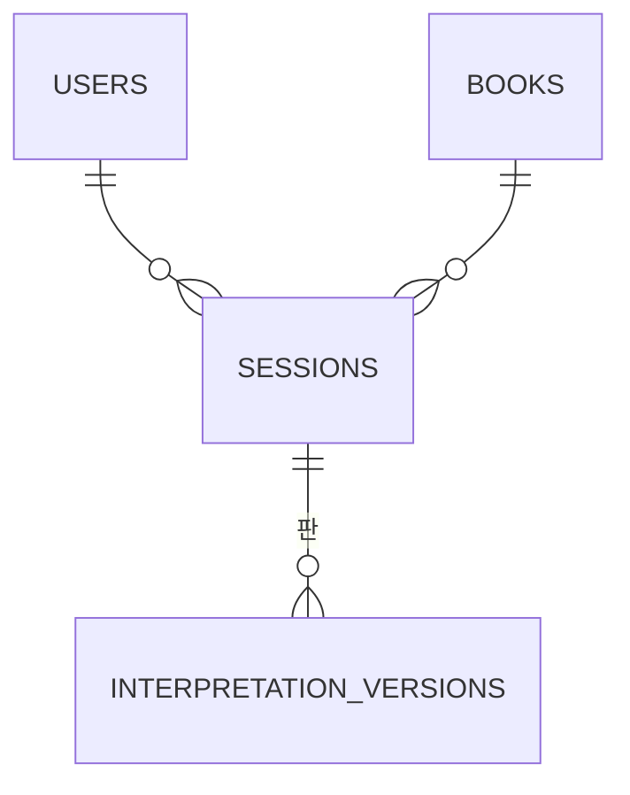

# spec-01-07: 모임과 내 해석 쓰기

## 📋 메타

| 항목 | 값 |
|---|---|
| **Spec ID** | `spec-01-07` |
| **Phase** | `phase-01` |
| **Branch** | `spec-01-07-interpretation` |
| **Base 브랜치** | `main` |
| **상태** | Planning |
| **타입** | Feature |
| **작성일** | 2026-11-18 |
| **소유자** | Changsik00 |

## 배경 및 문제 정의

### 현재 상황

책을 등록하고 볼 수 있다. 책 정보 화면의 "모임 시작"은 눌리지 않는다. 디자인 규칙(DESIGN.md)과 "내가 쓴 글"의 잉크(`ink-me`)는 정해졌지만 쓰인 적이 없다. 글쓰기 공통 규칙(자동 임시 저장, 떠날 때 묻기)은 ADR-007 §5 에 규칙만 있다.

### 문제점

- inkle 의 첫 원칙은 "먼저 쓰고, 그다음 본다"다. 독자가 반드시 쓰는 곳은 내 해석 한 번뿐이다 (`docs/goals.md` §원칙). 이 화면이 없으면 모임이 시작되지 않는다.
- 성공 기준 5: 내 해석을 저장하기 전에는 다른 시선과 비교가 화면과 API 어디에서도 나오지 않아야 한다. 그 문(門)을 지금 만들어야 이후 spec 이 그 위에 선다.

### 해결 방안

"모임"을 만들고, 그 안에서 소설용 질문에 답하는 형태로 내 해석을 쓰고 저장한다. 내 해석은 원본이라 고쳐 쓰면 새 판을 덧붙인다 (ADR-005). 저장 여부로 모임의 다음 단계가 열리는 문을 서버에 둔다.

## 요구사항

### 모임

1. 책 정보 화면에서 "모임 시작"을 누르면 그 책의 모임이 만들어지고 내 해석 쓰기로 간다. 모임은 사용자의 것이다 (ADR-003). 같은 책으로 모임을 여러 번 열 수 있다.
2. 책 정보 화면에 그 책으로 연 내 모임 목록(시작한 날, 내 해석 저장 여부)을 보여 주고, 누르면 이어서 간다.
3. 다른 사용자의 모임은 없는 것처럼 다룬다 (`NOT_FOUND`).

### 내 해석

4. 질문은 장르별 묶음이다. 소설 묶음은 수동 실험의 질문 넷을 쓴다 (`docs/experiments/01-manual-flow/prompts.md` §1):
   1. 이 책은 결국 무엇에 대한 이야기라고 읽었나요?
   2. 가장 오래 남은 장면이나 문장은 무엇이고, 왜 남았나요?
   3. 이해되지 않았거나 받아들이기 어려웠던 부분은 무엇인가요?
   4. 작가는 왜 이렇게 썼다고 생각하나요? (결말, 인물, 형식 중 하나를 골라서)
5. 하나 이상의 질문에 답하면 저장할 수 있다. 떠오르지 않는 질문은 비워 둔다. 답 하나는 4,000자까지.
6. 질문 묶음에는 판(`fiction-v1`)이 있고, 저장한 해석은 어느 판의 질문에 답했는지 함께 남긴다. 질문을 나중에 고쳐도 과거 해석의 뜻이 바뀌지 않는다.
7. 저장하면 새 판이 덧붙는다 (ADR-005). 지금 보이는 해석은 가장 최근 판이다. 이전 판은 지우지 않는다.
8. 내 해석의 글쓴이는 "나"다 (ADR-002 §3). 화면에서는 `ink-me` 잉크와 "내가 씀" 표시로 보인다.

### 쓰기 쉽게 (ADR-007 §5)

9. 쓰는 중인 글은 브라우저에 자동으로 임시 저장된다. 창을 닫았다 다시 열어도 남아 있다. 저장하면 임시본을 지운다.
10. 저장하지 않은 글이 있는데 떠나려 하면 묻는다.
11. 입력란은 글이 늘면 함께 늘어난다. 질문 아래에 지금 글자 수를 작게 보인다.

### 먼저 쓰고, 그다음 본다 (성공 기준 5)

12. 모임에는 단계가 있다: `writing`(내 해석 전) → `interpretation_saved`(이후). 단계는 저장된 해석이 있는지로 정해진다.
13. **문(門)**: 애플리케이션 층에 "다른 시선과 비교를 읽어도 되는가"를 판단하는 함수 하나를 둔다. 내 해석 전이면 `LOCKED` 오류. 이후 spec(배경, 시선, 비교)의 모든 읽기는 이 함수를 거쳐야 한다. 이번 spec 에서는 그런 읽기 API 가 아직 없으므로, 문 함수 자체와 "모임 조회 API 가 내 해석 전에는 다음 단계의 어떤 내용도 담지 않는다"를 테스트한다.
14. 내 해석을 저장한 뒤 화면은 "저장했어요"와 함께 다음 단계 안내를 보여 준다 (배경과 다른 시선은 아직 없으므로 "다음 단계는 준비 중이에요").

### 주소 (ADR-007 §1)

15. `/sessions/{sessionId}/interpretation`. `/sessions/{sessionId}` 는 지금 단계의 주소로 보낸다.

## Out of Scope

- 배경, 다른 시선, 비교, 끝의 한 번 고르기 (spec-01-09, 10)
- 자료 수집 연결 (spec-01-08 뒤)
- 이전 판 보기 화면 (판은 저장하지만 보여 주지 않는다)
- 모임 지우기
- 비문학 질문 (구조만 장르별로 둔다)

## 🛑 사용자 검토 필요

> [!IMPORTANT]
> - [ ] **질문 넷, 하나 이상 답하면 저장.** backlog 에는 "질문 두세 개"라고 적었지만, 수동 실험에서 넷에 모두 답하셨고 각 질문이 다른 걸 물어 넷을 그대로 쓰고 비워 둘 수 있게 했다. 질문 문구는 해요체로 바꿨다.
> - [ ] **고쳐 쓰기를 허용한다.** 저장한 뒤에도 "고쳐 쓰기"로 새 판을 저장할 수 있다. 다만 이후 단계(배경, 시선)를 본 뒤 고친 판은 "다른 시선을 본 뒤 고쳤다"는 표시를 남길 필요가 있다. 그 표시는 이후 단계가 생기는 spec 에서 더한다.
> - [ ] **임시본은 브라우저(`localStorage`)에만** 둔다. 서버에는 저장 버튼을 눌러야 남는다 (ADR-007 §5). 다른 기기에서 이어 쓰기는 안 된다.

> [!WARNING]
> - [ ] 모임 목록이 책 정보 화면에 생긴다. 모임을 많이 열면 길어지지만 지금은 페이지를 나누지 않는다.

## 핵심 전략

### 자료 (ADR-002 독자 단위, ADR-005 원본)



| 테이블 | 열 |
|---|---|
| `sessions` | `id`, `user_id`, `book_id`, `created_at` |
| `interpretation_versions` | `id`, `session_id`, `version` (모임 안에서 1부터, 유일), `question_set` (`fiction-v1`), `answers` (jsonb: `[{ questionId, text }]`), `author` (`me` 만), `created_at` |

`0003_sessions.sql`. 판 번호는 한 문장(insert … select max+1)으로 정하고, 같은 판 번호가 동시에 들어오면 유일 제약이 막는다.

### 계층 (ADR-006)

| 층 | 내용 |
|---|---|
| 도메인 | `session.ts`: 단계, 문 판단. `question-set.ts`: 장르별 질문 묶음(`fiction-v1`). `interpretation.ts`: 답 다듬기·검사(하나 이상, 4,000자) |
| 포트 | `SessionRepository` (create, findForUser, listForBook), `InterpretationRepository` (appendVersion, latest) |
| 유스케이스 | `startSession`, `getSession`(책, 질문 묶음, 최근 해석, 단계), `listSessionsForBook`, `saveInterpretation`, `requireUnlocked`(문) |
| 저장소 | Postgres, 메모리, 계약 테스트 |

### API (계약 `packages/contract/src/sessions.ts`)

| 메서드 | 주소 | 결과 | 오류 |
|---|---|---|---|
| POST | `/books/{bookId}/sessions` | 201 모임 | `NOT_FOUND` (책) |
| GET | `/books/{bookId}/sessions` | 내 모임 목록 | |
| GET | `/sessions/{sessionId}` | 모임: 책 요약, 질문 묶음, 최근 해석(없으면 null), 단계 | `NOT_FOUND` |
| PUT | `/sessions/{sessionId}/interpretation` | 저장한 판 | `NOT_FOUND`, `INVALID_INTERPRETATION` (이유) |

사용자는 서버가 정한다 (`currentUser`, ADR-003). 요청에 사용자 식별자를 받지 않는다.

### 화면

| 화면 | 내용 |
|---|---|
| 책 정보 | "모임 시작" 활성화. 아래에 "지난 모임" 목록 (가는 선의 행: 시작한 날, "내 해석 저장함 / 쓰는 중") |
| 내 해석 쓰기 | 책 제목(명조), 안내 한 줄, 질문 넷과 늘어나는 입력란(글자는 `ink-me`, `body-reading`), "내가 씀" 표시, 임시 저장 상태("임시 저장됨"), 저장 버튼. 저장 뒤에는 읽기 모드와 "고쳐 쓰기" |
| 공통 훅 | `apps/web/src/features/writing/use-draft.ts`: `localStorage` 임시 저장, 저장 뒤 지우기, 저장하지 않은 글이 있으면 떠날 때 묻기 |

새 부품: shadcn/ui `textarea` (DESIGN.md 의 `input` 규칙에 맞게 다듬음).

## Proposed Changes

#### [NEW] `packages/backend/src/domain/{session,question-set,interpretation}.ts` (+ 테스트)
#### [MODIFY] `packages/backend/src/application/ports.ts`, [NEW] `application/sessions.ts` (+ 테스트)
#### [NEW] `packages/backend/src/infrastructure/db/migrations/0003_sessions.sql`, `repositories/postgres-{session,interpretation}-repository.ts`
#### [NEW] `packages/backend/src/testing/{in-memory,contracts}/…` (모임, 해석)
#### [MODIFY] `packages/backend/src/container.ts`, `rpc/router.ts`, `testing/rpc.ts`; [NEW] `rpc/sessions.ts` (+ 테스트)
#### [NEW] `packages/contract/src/sessions.ts`, [MODIFY] `index.ts`
#### [NEW] `apps/web/src/features/sessions/`, `apps/web/src/features/writing/use-draft.ts`, `apps/web/src/ui/textarea.tsx`
#### [NEW] `apps/web/src/app/sessions/[sessionId]/page.tsx`, `apps/web/src/app/sessions/[sessionId]/interpretation/page.tsx`
#### [MODIFY] `apps/web/src/features/books/book-detail.tsx`
#### [NEW] `e2e/interpretation.spec.ts`
#### [MODIFY] `docs/architecture.md` (포트, 데이터, 흐름), `README.md`, `backlog/phase-01.md`

## 검증 계획

```bash
pnpm lint && pnpm typecheck && pnpm test:unit
docker compose up -d --wait
pnpm test && pnpm test:e2e && pnpm build
```

수동 검증 시나리오:
1. 책 정보 → "모임 시작" → 질문 넷이 보이는 쓰기 화면 — 기대: 주소가 `/sessions/{id}/interpretation`.
2. 두 질문에 답하고 창을 닫았다 다시 연다 — 기대: 쓴 글이 남아 있다 (임시본).
3. 저장하지 않고 다른 주소로 가려 한다 — 기대: 떠날지 묻는다.
4. 저장 → "저장했어요"와 다음 단계 안내, 글이 `ink-me` 잉크로 보인다. 새로고침해도 남아 있다.
5. "고쳐 쓰기" → 고쳐 저장 — 기대: DB 에 판 2 가 생기고 판 1 이 남아 있다.
6. 책 정보로 돌아간다 — 기대: "지난 모임"에 이 모임이 "내 해석 저장함"으로 보인다.
7. 아무 질문에도 답하지 않고 저장 — 기대: 서버에 보내지 않고 이유를 보여 준다.

## 롤백 계획

- `git revert`. `0003_sessions.sql` 은 되돌리기 마이그레이션이 없으므로 되돌릴 때는 두 테이블을 지운다 (`drop table interpretation_versions, sessions`) 또는 DB 볼륨을 지운다.

## ADR 후보

- [ ] ADR 가치 있는 결정 있음
- [x] 없음. 문(門)을 애플리케이션 층에 둔다는 것은 ADR-004 §7 의 구현이다. 질문 묶음의 판은 ADR-005 의 적용이다.

## ✅ Definition of Done

- [ ] 모든 테스트 PASS, lint 와 타입 검사 통과, 빌드와 E2E 통과
- [ ] 수동 검증 시나리오 7개 확인, 스크린숏 (`docs/design/screens/`)
- [ ] `walkthrough.md` 와 `pr_description.md` 작성 및 ship commit
- [ ] `spec-01-07-interpretation` 브랜치 push 완료
