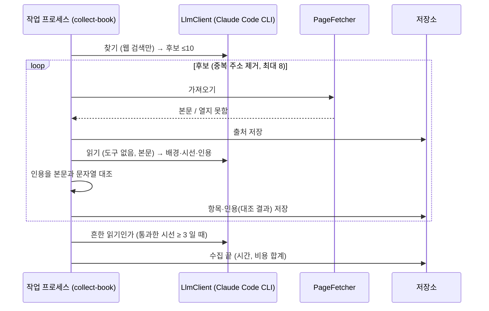

# spec-01-08: 자료 수집 (배경과 시선, 출처 대조)

## 📋 메타

| 항목 | 값 |
|---|---|
| **Spec ID** | `spec-01-08` |
| **Phase** | `phase-01` |
| **Branch** | `spec-01-08-collection` |
| **Base 브랜치** | `main` |
| **상태** | Planning |
| **타입** | Feature |
| **작성일** | 2026-11-18 |
| **소유자** | Changsik00 |

## 배경 및 문제 정의

### 현재 상황

모임을 열고 내 해석을 저장할 수 있다. 내 해석 뒤에 볼 배경과 다른 시선은 아직 없다. 작업 대기열과 호스트의 작업 프로세스는 있지만 처리기는 시험용 하나뿐이다. ADR-004 가 수집 절차(찾기 → 가져오기 → 읽기 → 대조)를 정했고, spec-01-03 에서 CLI 비대화 실행·웹 검색·결과 형식·본문 추출이 되는 것을 확인했다.

### 문제점

- 다음 두 화면(spec-01-09 배경, spec-01-10 시선과 비교)이 쓸 자료가 없다.
- 수동 실험에서 검색 요약 7개 중 2개가 원문과 달랐다. 출처를 직접 열어 문장을 대조하지 않으면 틀린 출처가 나간다 (성공 기준 4: 0건).
- 수집은 분 단위로 걸리고 비싸다. 독자가 내 해석을 쓰는 동안 뒤에서 돌아야 한다.

### 해결 방안

작업 프로세스에 "책 수집" 처리기를 만든다. LLM 은 하나의 경계(포트) 뒤에서 Claude Code CLI 로 부르고, 페이지는 앱이 직접 가져와 인용 문장을 문자열로 대조한다. 결과는 책 단위로 저장하고, 대조를 통과한 인용이 있는 항목만 "보여 줄 수 있음"이 된다. 화면은 없다. 실험에 쓴 두 책으로 실제로 돌려 통과율·시간·비용을 잰다.

## 요구사항

### 수집 절차 (ADR-004 §2)

1. **찾기** (LLM, 웹 검색만): 책의 제목·작가·장르로 평론, 작가 인터뷰, 독자 반응 후보를 최대 10개 낸다. 후보마다 주소, 누가 한 말인지, 무엇에 쓰일지(배경 / 시선).
2. **가져오기** (코드): 후보 주소를 직접 연다. 시간 제한 20초, 2MB 까지, HTML 만. 본문 글자를 뽑아 출처로 저장한다. 열지 못하면 "열지 못함"과 이유로 저장하고 쓰지 않는다 (ADR-004 §8). 접근 제한을 우회하지 않는다.
3. **읽기** (LLM, 도구 없음): 출처 하나씩, 본문에서 배경 항목과 시선을 뽑는다. 항목마다 본문에서 **그대로 옮긴 인용**과 출처의 종류(직접 인용 / 정리 / 재인용). 한국어가 아닌 인용에는 한국어 옮김을 붙인다.
4. **대조** (코드): 인용이 그 출처의 본문에 실제로 있는지 문자열로 확인한다. 공백, 따옴표 모양(“” ‘’ 「」 『』), 줄임표(… / ...)의 차이만 맞춰 준다.
5. **흔한 읽기인가** (LLM, 도구 없음): 대조를 통과한 시선들을 모아 각 시선이 다수 의견 / 일부 / 드문 읽기인지 붙인다. 통과한 시선이 셋 미만이면 모두 "알 수 없음"이다 (ADR-002 §2).

### 저장 (ADR-002 책 단위, ADR-005 파생물)

6. 자료는 책 단위로 저장하고 독자와 무관하다: 수집 기록(collection), 출처, 배경 항목, 시선, 인용.
7. 배경 항목의 설명과 시선의 요약, 한국어 옮김은 글쓴이가 AI 다. 인용 원문은 글쓴이가 외부 사람이다 (ADR-002 §3). 따로 저장한다.
8. 모든 항목은 어느 수집에서, 어느 모델과 어느 지시문 판으로 만들었는지 남긴다 (ADR-005).
9. **보여 줄 수 있는 항목** = 대조를 통과한 인용이 하나 이상 있는 항목. 통과하지 못한 항목도 지우지 않고 저장한다 (나중에 다시 대조하거나 원인을 본다).
10. 수집마다 상태(대기 / 진행 중 / 끝남 / 실패), 걸린 시간, CLI 가 보고한 비용 추정치 합계를 남긴다.

### 시작 시점 (ADR-004 §7)

11. 모임을 시작하면 그 책의 수집이 대기열에 들어간다. 그 책에 끝났거나 진행 중인 수집이 있으면 넣지 않는다.
12. 수집 결과를 읽는 HTTP API 는 이 spec 에서 만들지 않는다 (spec-01-09, 10 이 문(門)을 거쳐 만든다).
13. 손으로 확인하는 명령: `pnpm collect <책 번호>` (대기열에 넣기, `--force` 로 다시), `pnpm collect:report <책 번호>` (최근 수집의 출처·항목·대조 결과·비용을 글로 출력).

### LLM 경계 (ADR-004 §1)

14. 포트 `LlmClient`: 지시문, 결과 형식(JSON 스키마), 웹 검색 허용 여부를 받아 형식에 맞는 결과와 모델·비용을 돌려준다. 받은 결과를 코드로 다시 검사하고, 형식이 틀리면 한 번 다시 시도한다.
15. 구현 `ClaudeCodeCli`: `claude -p --output-format json --json-schema … --tools …` 를 프로젝트 설정이 없는 빈 임시 디렉토리에서, 표준 입력을 닫고 실행한다. 호출당 시간 제한 5분. 모델은 환경 변수로 바꿀 수 있고 기본은 CLI 의 기본 모델이다.
16. 지시문은 저장소의 파일로 두고 판 번호를 붙인다 (`find.v1`, `read.v1`, `prevalence.v1`).
17. 포트 `PageFetcher`: 주소를 열어 본문 글자를 돌려준다. 구현은 HTTP 요청과 본문 추출(`linkedom`, `@mozilla/readability`).

### 실제 확인

18. 『채식주의자』, 『노인과 바다』 로 실제로 돌려 `docs/experiments/03-collection/README.md` 에 기록한다: 후보 수, 열린 출처 수, 항목 수, 인용 대조 통과율, 보여 줄 수 있는 항목 수, 걸린 시간, 비용 추정치, 수동 실험(`rehearsal.md`, `book-1.md`)과의 비교. 보여 줄 수 있는 항목의 출처를 몇 개 직접 열어 실제로 그 내용을 담는지 확인한다.

## Out of Scope

- 배경·시선·비교의 화면과 API (spec-01-09, 10)
- AI 가 만든 해석으로 시선 채우기 (ADR-004 §6) — 시선 화면을 만드는 spec-01-10 에서
- 내 해석과 배경의 연결(독자 단위), 비교
- 수집을 다시 하는 주기, 새 평론 반영
- 비문학

## 🛑 사용자 검토 필요

> [!IMPORTANT]
> - [ ] **실제 CLI 호출은 구독 사용량을 쓴다.** 책 한 권에 대략 찾기 1회 + 읽기 최대 8회 + 분포 1회. spec-01-03 의 측정(짧은 호출 0.03~0.4 달러 추정치)으로 보면 한 권에 몇 달러어치의 추정치가 나올 수 있다. 두 책을 실제로 돌린다.
> - [ ] **모임을 시작하면 수집이 자동으로 대기열에 들어간다.** 작업 프로세스(`pnpm worker`)를 띄워 두지 않으면 쌓여만 있다.
> - [ ] **대조는 엄격하다**: 공백·따옴표·줄임표 차이만 허용한다. 맞춤법을 고쳐 옮기거나 문장을 줄이면 통과하지 못한다. 그만큼 보여 줄 항목이 줄 수 있고, 통과율을 이번에 잰다.
> - [ ] **AI 가 만든 해석은 이번에 만들지 않는다.** 시선이 부족한 책의 처리는 spec-01-10.
> - [ ] **가져온 페이지 본문 전체를 로컬 DB 에 보관한다** (ADR-004 §8, 다시 대조하고 다시 만들기 위해).

> [!WARNING]
> - [ ] CLI 의 결과 형식이나 판이 바뀌면 경계 구현이 깨질 수 있다. CLI 판을 이미지와 같이 고정하지 않고 호스트의 것을 쓴다 (작업 프로세스가 호스트에서 돈다).

## 핵심 전략

### 흐름



### 계층 (ADR-006)

| 층 | 내용 |
|---|---|
| 도메인 | `quote-match.ts` (정규화와 대조), `collection.ts` (상태, 보여 줄 수 있음, 흔한 읽기), 출처·항목·인용 타입 |
| 애플리케이션 | 포트 `LlmClient`, `PageFetcher`, `CollectionRepository`. 유스케이스 `collectBook`(절차 전체), `enqueueCollectionIfNeeded`, `collectionReport` |
| 지시문 | `packages/backend/src/collection/prompts/{find,read,prevalence}.v1.md` 와 결과 스키마(zod → JSON 스키마) |
| 인프라 | `ClaudeCodeCli`, `HttpPageFetcher`, Postgres 저장소, `0004_collections.sql` |
| 진입점 | 작업 처리기 `collect-book`, `apps/api` 명령 `collect`, `collect:report`. `startSession` 이 수집을 대기열에 넣는다 |

### 자료 (`0004_collections.sql`)

| 테이블 | 주요 열 |
|---|---|
| `collections` | `book_id`, `status`, `error`, `model`, `prompt_versions`, `cost_usd`, `started_at`, `finished_at` |
| `sources` | `collection_id`, `book_id`, `url`, `final_url`, `who`, `role`, `fetch_status`(ok / unreachable), `fetch_error`, `page_text`, `article_text`, `fetched_at` |
| `background_items` | `collection_id`, `book_id`, `source_id`, `topic`(시대 / 작가의 삶 / 작가의 의도 / 그 밖), `claim_ko`(AI), `model`, `prompt_version` |
| `perspectives` | `collection_id`, `book_id`, `source_id`, `who`, `role`(평론가 / 작가 / 독자 / 그 밖), `reading_ko`(AI), `prevalence`, `model`, `prompt_version` |
| `quotes` | `source_id`, `background_item_id` 또는 `perspective_id`, `text`(원문 그대로, 외부 사람), `lang`, `translation_ko`(AI), `source_kind`(직접 인용 / 정리 / 재인용), `verified` |

### 테스트

| 대상 | 방식 |
|---|---|
| 대조 규칙 | 단위 테스트: 공백·따옴표·줄임표, 고친 맞춤법은 실패, 다른 출처의 문장은 실패 |
| 절차 | `collectBook` 을 메모리 저장소와 **대역 LLM**(정해 둔 결과를 돌려줌), **대역 PageFetcher** 로: 열지 못한 출처 제외, 대조 실패 인용 표시, 통과 인용 없는 항목은 보여 줄 수 없음, 시선 셋 미만이면 알 수 없음, 형식이 틀린 결과는 한 번 다시 시도, 한 출처의 실패가 전체를 멈추지 않음, 비용 합계와 출처 기록 |
| CLI 경계 | 가짜 `claude` 실행 파일(셸 스크립트)을 넣어: 인자(`-p`, `--json-schema`, `--tools`), 빈 디렉토리, 표준 입력 닫힘, `structured_output` 읽기, 없으면 다시 시도, 시간 제한 |
| 페이지 가져오기 | 테스트 안에서 띄운 로컬 HTTP 서버: 본문 추출, 404·HTML 아님·너무 큼·시간 초과는 열지 못함 |
| 저장소 | 계약 테스트 (메모리, Postgres) |
| 대기열 | 모임 시작 시 한 번만 들어감, 끝난 수집이 있으면 안 들어감 |

실제 CLI 와 실제 웹은 자동 테스트에서 부르지 않는다. 요구사항 18 의 수동 실행으로 확인한다.

## Proposed Changes

#### [NEW] `packages/backend/src/domain/{quote-match,collection}.ts` (+ 테스트)
#### [MODIFY] `packages/backend/src/application/ports.ts`, `sessions.ts`(수집 대기열); [NEW] `application/collection.ts` (+ 테스트)
#### [NEW] `packages/backend/src/collection/prompts/*.v1.md`, `collection/schemas.ts`
#### [NEW] `packages/backend/src/infrastructure/{llm/claude-code-cli.ts, web/http-page-fetcher.ts, repositories/postgres-collection-repository.ts}` (+ 테스트), `db/migrations/0004_collections.sql`
#### [NEW] `packages/backend/src/testing/{in-memory/in-memory-collection-repository.ts, contracts/collection-repository.contract.ts, fakes/{llm,page-fetcher}.ts}`
#### [MODIFY] `packages/backend/src/{container.ts, worker/handlers.ts, testing/rpc.ts}`, `packages/backend/package.json`(`linkedom`, `@mozilla/readability` 사용)
#### [NEW] `apps/api/src/cli/{collect,collect-report}.ts`, 루트·`apps/api` 명령
#### [NEW] `docs/experiments/03-collection/README.md`
#### [MODIFY] `docs/architecture.md`, `docs/decisions/ADR-004` (실제 측정 결과), `README.md`, `backlog/phase-01.md`

## 검증 계획

```bash
pnpm lint && pnpm typecheck && pnpm test:unit
docker compose up -d --wait && pnpm test && pnpm test:e2e && pnpm build
# 실제 확인 (구독 사용량 사용)
pnpm worker &
pnpm collect <채식주의자 번호> && pnpm collect <노인과 바다 번호>
pnpm collect:report <책 번호>
```

수동 검증 시나리오:
1. 모임을 시작하면 수집 작업이 하나 들어가고, 같은 책으로 다시 시작해도 더 들어가지 않는다.
2. 두 책의 수집이 끝나고 보고서에 출처·항목·대조 결과·비용이 나온다.
3. 보여 줄 수 있는 항목 가운데 출처 다섯 개 이상을 직접 열어 인용이 실제로 있는지 본다 — 기대: 틀린 것 0건.
4. 실험 기록과 비교해 통과율, 시간, 비용을 `docs/experiments/03-collection/README.md` 에 적는다.

## 롤백 계획

- `git revert`. `0004_collections.sql` 의 테이블은 되돌릴 때 지운다. 대기열에 남은 `collect-book` 작업은 처리기가 없으면 실패로 기록되므로 해가 없다.

## ADR 후보

- [ ] ADR 가치 있는 결정 있음
- [x] 없음. ADR-004 의 구현이다. 실제 측정 결과(통과율, 비용)는 ADR-004 §가정의 확인 결과 옆에 덧붙인다.

## ✅ Definition of Done

- [ ] 모든 테스트 PASS, lint 와 타입 검사 통과, 빌드와 E2E 통과
- [ ] 두 책의 실제 수집과 기록, 출처 직접 확인에서 틀린 것 0건
- [ ] `walkthrough.md` 와 `pr_description.md` 작성 및 ship commit
- [ ] `spec-01-08-collection` 브랜치 push 완료
