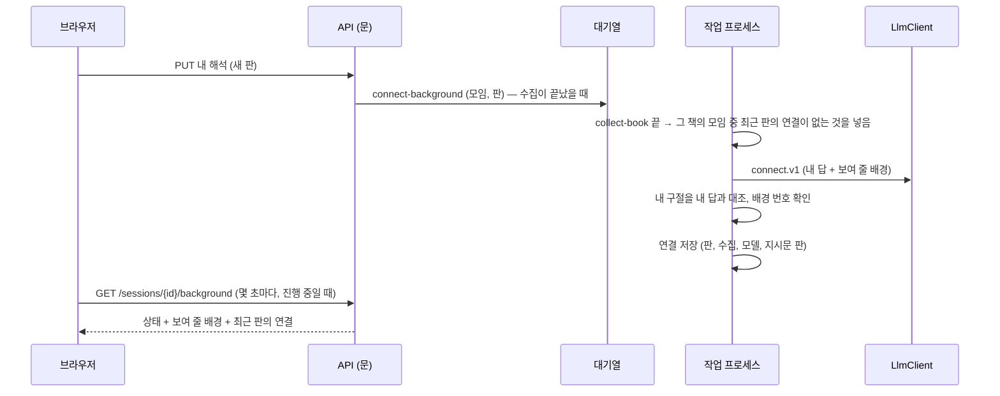

# spec-01-09: 배경과 작가의 의도

## 📋 메타

| 항목 | 값 |
|---|---|
| **Spec ID** | `spec-01-09` |
| **Phase** | `phase-01` |
| **Branch** | `spec-01-09-background` |
| **Base 브랜치** | `main` |
| **상태** | Planning |
| **타입** | Feature |
| **작성일** | 2026-11-20 |
| **소유자** | Changsik00 |

## 배경 및 문제 정의

### 현재 상황

모임을 열고 내 해석을 저장할 수 있다 (spec-01-07). 모임을 시작하면 그 책의 자료가 뒤에서 수집되어, 출처와 대조를 통과한 인용이 붙은 배경 항목이 책 단위로 쌓인다 (spec-01-08, 실제 두 책에서 9~25개). 이 자료를 읽는 API 와 화면은 없다. 문(門) `requireUnlocked` 는 있지만 아직 거치는 API 가 없다.

### 문제점

- 내 해석을 저장한 뒤 볼 것이 없다. phase-01 흐름의 3번째 단계가 비어 있다.
- 배경을 그대로 늘어놓으면 일반적인 작품 소개가 된다. 수동 실험에서 효과가 있었던 것은 배경을 **내 해석의 특정 부분 옆에** 두는 것이었다 (`01-manual-flow/rehearsal.md` 알게 된 것 3, `findings.md` 4).
- 수집은 분 단위로 걸리고 실패할 수 있다. 화면이 그 상태를 알려야 한다.

### 해결 방안

내 해석이 저장되면 독자 단위 작업 "연결 만들기"를 넣는다. LLM 이 수집된 배경 항목 가운데 내 해석과 맞닿는 것을 골라 **내 해석의 문장을 그대로 인용**하며 한 줄로 잇고, 코드가 그 인용이 내 답에 실제로 있는지 문자열로 대조한다. 배경 화면은 맞닿는 배경을 연결과 함께 위에 두고, 나머지는 접어 둔다. 모든 글에 글쓴이(나 / AI / 외부 사람)를 표시한다.

## 요구사항

### 연결 (독자 단위, ADR-002, ADR-004 §7)

1. **연결** = 배경 항목 하나 + 내 해석에서 그대로 옮긴 구절 + 어떻게 맞닿는지 한 줄(AI). 연결은 모임의 내 해석 **판 하나**에 대해 만든다.
2. 내 해석을 저장하면(새 판 포함) 그 판의 연결 만들기가 대기열에 들어간다. 그 책의 수집이 아직 끝나지 않았으면, 수집이 끝날 때 그 책의 모임들 가운데 최근 판의 연결이 없는 모임에 넣는다. 같은 판·같은 수집으로는 한 번만 만든다.
3. 지시문 `connect.v1` (LLM, 도구 없음): 입력은 질문과 내 답, 그 책의 **보여 줄 수 있는** 배경 항목(번호, 주제, 설명, 대조를 통과한 인용). 출력은 연결 최대 5개: 배경 항목 번호, 내 답에서 그대로 옮긴 구절, 맞닿는 방식 한 줄. 독자를 평가하지 않는다 (성향·수준 언급 금지, `docs/goals.md` 원칙).
4. **대조** (코드): 구절이 내 답 가운데 하나에 그대로 있는지 spec-01-08 의 `matchQuote` 로 확인하고, 있으면 그 질문 번호를 남긴다. 배경 항목 번호가 입력 목록에 없으면 버린다. 대조를 통과하지 못한 연결은 저장하되 보여 주지 않는다.
5. 새 판으로 다시 만들어도 이전 판의 연결은 지우지 않는다 (ADR-005). 화면은 최근 판의 연결을 쓴다.
6. 연결 만들기마다 상태(대기 / 진행 중 / 끝남 / 실패), 쓴 수집, 모델, 지시문 판, 비용 추정치를 남긴다. 형식 오류나 실패는 한 번 다시 묻는다 (spec-01-08 과 같음).

### 배경 API (문을 거친다)

7. `GET /api/sessions/{id}/background`: `requireUnlocked` 를 거친다. 내 해석 전이면 잠김 오류, 다른 사용자의 모임이면 찾을 수 없음. 응답:
   - 수집 상태: 모으는 중 / 끝남 / 실패 / 없음
   - 연결 상태: 기다리는 중(수집 전) / 만드는 중 / 끝남 / 실패
   - 보여 줄 수 있는 배경 항목만: 주제, 설명(AI), 출처(주소, 누가), 인용(원문은 외부 사람, 옮김은 AI, 출처의 종류), 그리고 최근 판의 연결이 있으면 연결(내 구절은 나, 한 줄은 AI, 질문 번호)
8. `POST /api/sessions/{id}/background/recollect`: 문을 거친다. 그 책의 최근 수집이 **실패했거나 없을 때만** 수집을 다시 넣는다. 끝났거나 진행 중이면 아무것도 하지 않는다.
9. 잠긴 모임에는 수집 상태도 내주지 않는다 (ADR-004 §7 은 상태만 허용하지만, 지금 화면에서 쓸 곳이 없다).

### 배경 화면 `/sessions/{id}/background`

10. 내 해석을 저장한 화면에 "배경 보기"로 들어간다. 내 해석 전에 주소로 들어오면 내 해석 쓰기로 안내한다.
11. **맞닿는 배경**: 연결이 있는 배경을 위에 둔다. 각 항목에 내 구절(내 글 잉크, "내가 씀"), 맞닿는 한 줄(AI 글, "AI 가 씀"), 배경 설명(AI), 인용(외부 인용 모양, 누가·어디서, 출처의 종류, 원문 주소 링크). 외국어 인용은 원문과 한국어 옮김("AI 가 옮김")을 함께.
12. **다른 배경**: 나머지는 주제별(시대 / 작가의 삶 / 작가의 의도 / 그 밖)로 접어 둔다. 맞닿는 배경이 하나도 없으면 펼쳐 둔다.
13. **진행 상황**: 수집이나 연결이 진행 중이면 그 상태를 보여 주고 몇 초마다 다시 읽는다. 수집은 끝났는데 연결이 아직이면 배경을 먼저 보여 주고 "연결을 만드는 중"을 붙인다.
14. **확인하지 못함**: 수집이 실패했거나 없거나, 끝났는데 보여 줄 배경이 없으면 "확인하지 못함"을 보여 준다. 실패·없음이면 "다시 모으기" 버튼(요구사항 8).
15. 글쓴이 표시 컴포넌트를 이 spec 에서 만든다 (DESIGN.md 는 spec-01-10 으로 적어 두었으나 배경 화면에 먼저 필요하다). 색만이 아니라 글자 표시를 붙인다.

### 실제 확인

16. 『채식주의자』, 『노인과 바다』 에 수동 실험의 해석(`01-manual-flow/rehearsal.md`, `book-1.md`)을 넣어 실제로 연결을 만들고 기록한다: 연결 수, 내 구절 대조 통과율, 시간, 비용, 수동 실험의 "배경 ↔ 맞닿는 해석" 표와의 비교. 화면 스크린숏을 남긴다.

## Out of Scope

- 다른 시선, 비교, AI 가 만든 해석 (spec-01-10)
- 배경 화면에서 연결을 다시 만들기, 연결에 대한 독자의 반응 (좋음/아님)
- 이전 판의 연결 보기
- 수집을 주기적으로 새로 하기

## 🛑 사용자 검토 필요

> [!IMPORTANT]
> - [x] **보여 줄 범위**: 맞닿는 배경을 위에, 나머지는 접기 (2026-11-20 사용자 결정)
> - [x] **연결의 근거**: 내 해석의 구절을 그대로 인용하고 문자열로 대조 (사용자 결정)
> - [x] **수집 실패**: "확인하지 못함" + "다시 모으기" 버튼 (사용자 결정). 버튼은 구독 사용량을 쓴다
> - [x] **고쳐 쓴 뒤**: 새 판마다 연결을 새로 만들고 이전 것은 남김 (사용자 결정). 판마다 LLM 호출 한 번
> - [ ] **실제 확인은 구독 사용량을 쓴다**: 두 책의 연결 만들기(호출 각 한 번 남짓). 모델은 지금처럼 `INKLE_LLM_MODEL=claude-sonnet-5-5`
> - [ ] **글쓴이 표시 컴포넌트를 spec-01-10 에서 당겨 온다**. DESIGN.md 의 해당 문장을 고친다

> [!WARNING]
> - [ ] 연결 만들기가 대기열에 들어가려면 작업 프로세스(`pnpm worker`)가 떠 있어야 한다. 떠 있지 않으면 화면은 "연결을 만드는 중"에 머문다.
> - [ ] 짧은 답(10자 미만 구절만 가능한 답)에는 연결이 붙지 못한다 (대조 규칙의 최소 길이).

## 핵심 전략

### 흐름



### 계층 (ADR-006)

| 층 | 내용 |
|---|---|
| 도메인 | `connection.ts`: 연결·연결 만들기 타입, 상태 전이, 화면용 정렬(맞닿는 것 먼저, 나머지 주제별) |
| 애플리케이션 | `connections.ts`: `enqueueConnections`(저장 뒤·수집 끝 뒤), `connectBackground`(처리기 본체), `backgroundView`(문 + 조합), `recollect`. 포트 `ConnectionRepository`, `SessionRepository.listByBook`(사용자 무관, 작업용). 지시문 `prompts/connect.v1.ts` |
| 인프라 | Postgres 저장소, `0005_connections.sql` |
| 진입점 | 작업 처리기 `connect-background`, `collect-book` 끝에 연결 넣기, 계약과 rpc `background.get`, `background.recollect` |
| 화면 | `features/background/` (화면, 항목, 진행 상황), `ui/` 또는 `features/authorship/` 의 글쓴이 표시, `app/sessions/[sessionId]/background/page.tsx`, 내 해석 화면의 "배경 보기" |

### 자료 (`0005_connections.sql`)

| 테이블 | 주요 열 |
|---|---|
| `connection_runs` | `session_id`, `interpretation_version`, `collection_id`, `status`, `error`, `model`, `prompt_version`, `cost_usd`, 시각. 유일: (모임, 판, 수집) |
| `connections` | `run_id`, `session_id`, `background_item_id`, `my_quote`(글쓴이 나), `question_id`, `note_ko`(글쓴이 AI), `verified`, `seq` |

사용자 식별자는 모임을 거쳐 이어진다 (`sessions.user_id`, ADR-003).

### 테스트

| 대상 | 방식 |
|---|---|
| 연결 대조 | 단위: 내 답에 있는 구절은 통과하고 질문 번호를 찾음, 고친 구절·없는 구절·짧은 구절은 실패, 목록 밖 배경 번호는 버림 |
| 대기열 | 저장하면 넣음, 수집 전이면 넣지 않음, 수집이 끝나면 그 책의 모임에 넣음, 같은 판·수집은 한 번 |
| 처리기 | 대역 LLM 으로: 저장, 다시 묻기, 실패 기록, 보여 줄 배경이 없으면 LLM 을 부르지 않고 끝남 |
| 문 | `background.get`·`recollect` 는 내 해석 전 잠김, 다른 사용자는 찾을 수 없음, 잠긴 응답에 상태·개수 없음 |
| API 모양 | 응답 키 고정, 글쓴이 필드, OpenAPI 스냅샷 |
| 저장소 | 계약 테스트 (메모리, Postgres) |
| 화면 | 브라우저 테스트(MSW): 맞닿는 배경 위·나머지 접힘, 글쓴이 표시, 외국어 옮김, 진행 중 다시 읽기, 확인하지 못함과 다시 모으기, 잠김 안내 |
| 흐름 (E2E) | 내 해석 저장 → 배경 보기 → 진행 상황(작업 프로세스 없음). 저장 전에는 API 가 잠김 |

실제 CLI 는 자동 테스트에서 부르지 않는다. 요구사항 16 의 수동 실행으로 확인한다.

## Proposed Changes

#### [NEW] `packages/backend/src/domain/connection.ts` (+ 테스트)
#### [NEW] `packages/backend/src/application/connections.ts` (+ 테스트), `application/prompts/connect.v1.ts`
#### [MODIFY] `packages/backend/src/application/{ports.ts, sessions.ts, collection.ts}` — 저장 뒤·수집 끝 뒤 연결 넣기, `listByBook`
#### [NEW] `packages/backend/src/infrastructure/db/migrations/0005_connections.sql`, `repositories/postgres-connection-repository.ts`; [MODIFY] `postgres-session-repository.ts`
#### [NEW] `packages/backend/src/testing/{contracts/connection-repository.contract.ts, in-memory/in-memory-connection-repository.ts}`; [MODIFY] 세션 저장소 계약·메모리 구현, `testing/rpc.ts`
#### [NEW] `packages/contract/src/background.ts`, `packages/backend/src/rpc/background.ts` (+ 테스트); [MODIFY] 라우터, OpenAPI 스냅샷
#### [MODIFY] `packages/backend/src/{container.ts, worker/handlers.ts}`
#### [NEW] `apps/web/src/features/background/`, 글쓴이 표시 컴포넌트, `apps/web/src/app/sessions/[sessionId]/background/page.tsx`; [MODIFY] 내 해석 화면, `apps/web/src/testing/fixtures.ts`
#### [NEW] `e2e/background.spec.ts`, `docs/design/screens/background*.png`, `docs/experiments/04-connections/README.md`
#### [MODIFY] `DESIGN.md`(글쓴이 표시 컴포넌트 시점), `docs/architecture.md`, `README.md`, `backlog/phase-01.md`

## 검증 계획

```bash
pnpm lint && pnpm typecheck && pnpm test:unit
docker compose up -d --wait && pnpm test && pnpm test:e2e && pnpm build
# 실제 확인 (구독 사용량 사용)
INKLE_LLM_MODEL=claude-sonnet-5-5 pnpm worker
```

수동 검증 시나리오:
1. 내 해석 전 `/sessions/{id}/background` → 내 해석 쓰기로 안내, API 는 잠김.
2. 두 책에 수동 실험의 해석을 저장 → 연결이 만들어지고 맞닿는 배경이 위에, 나머지는 접힘.
3. 연결의 내 구절이 내가 쓴 답에 그대로 있고, 맞닿는 한 줄이 독자를 평가하지 않는다.
4. 내 해석을 고쳐 쓰면 새 연결, DB 에 이전 판의 연결이 남음.
5. 수집이 실패한 책 → 확인하지 못함 + 다시 모으기 → 모으는 중.
6. 결과를 `docs/experiments/04-connections/README.md` 에, 스크린숏을 `docs/design/screens/` 에.

## 롤백 계획

- `git revert`. `0005_connections.sql` 의 테이블은 되돌릴 때 지운다. 대기열에 남은 `connect-background` 작업은 처리기가 없으면 실패로 기록되므로 해가 없다.

## ADR 후보

- [ ] ADR 가치 있는 결정 있음
- [x] 없음. 연결은 ADR-002 의 자료, 대조는 ADR-004 §2 를 내 글에 적용한 것, 판마다 다시 만들기는 ADR-005 의 적용이다.

## ✅ Definition of Done

- [ ] 모든 테스트 PASS, lint 와 타입 검사 통과, 빌드와 E2E 통과
- [ ] 두 책의 실제 연결과 기록, 스크린숏
- [ ] `walkthrough.md` 와 `pr_description.md` 작성 및 ship commit
- [ ] `spec-01-09-background` 브랜치 push 완료
