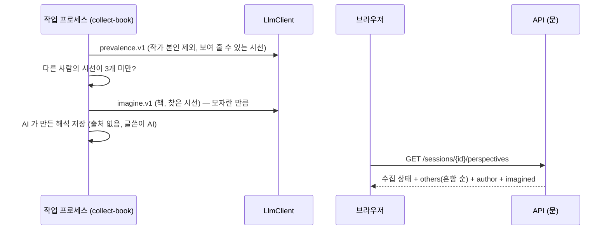

# spec-01-10: 다른 시선

## 📋 메타

| 항목 | 값 |
|---|---|
| **Spec ID** | `spec-01-10` |
| **Phase** | `phase-01` |
| **Branch** | `spec-01-10-perspectives` |
| **Base 브랜치** | `main` |
| **상태** | Planning |
| **타입** | Feature |
| **작성일** | 2026-11-20 |
| **소유자** | Changsik00 |

## 배경 및 문제 정의

### 현재 상황

모임을 열고 내 해석을 쓰면, 그 책에 대해 모은 배경을 내 해석과 이어서 볼 수 있다 (spec-01-07 ~ 09). 같은 수집(spec-01-08)이 **시선**(이 책을 이렇게 읽었다는 해석 하나)도 모아 두었다. 실제 두 책에서 보여 줄 수 있는 시선이 12~18개였고, 모두 대조를 통과한 인용과 출처, 누가 한 말인지(평론가 / 작가 본인 / 독자 / 그 밖), 얼마나 흔한 읽기인지(다수 / 일부 / 드문 / 알 수 없음)를 가진다. 이 시선을 읽는 API 와 화면은 없다.

### 문제점

- 흐름의 4단계(다른 시선)가 비어 있다.
- 작가 본인의 말에도 "다수 의견 / 드문 읽기"가 붙는데 뜻이 없다 (`docs/experiments/03-collection/README.md` 알게 된 것 2).
- 실제 사람의 시선이 부족한 책(덜 알려진 책)에서는 보여 줄 것이 없다. ADR-004 §6 은 이때만 AI 가 만든 해석을 덧붙인다고 정했으나 만들지 않았다.

### 해결 방안

내 해석을 쓴 모임에서 문(門)을 거쳐 그 책의 시선을 내주는 API 와 화면을 만든다. 흔함 정도는 작가 본인이 아닌 사람의 읽기에만 붙이고, 작가 본인의 말은 따로 묶는다. 수집이 끝났을 때 다른 사람의 시선이 3개보다 적으면 AI 가 만든 해석을 그만큼 덧붙이고, 화면에서 실제 사람의 글과 섞이지 않게 표시한다.

비교("책과 어긋나는 곳", "다르게 읽은 곳")와 끝의 한 번 고르기는 spec-01-11 에서 한다 (2026-11-20 사용자 결정으로 나눔).

## 요구사항

### 흔함 정도 (ADR-002 §2)

1. 흔함 정도는 **작가 본인이 아닌** 시선(평론가, 독자, 그 밖)에만 붙인다. 작가 본인의 시선은 흔함 정도가 없다 (화면에서도 내주지 않는다).
2. 흔함을 매기는 단계(`prevalence.v1`)에는 작가 본인이 아닌, 보여 줄 수 있는 시선만 넘긴다. "다수 의견"을 말할 수 있는 최소 개수(3)도 이 시선들로 센다.
3. 이미 모은 자료에 작가 본인의 흔함 값이 남아 있어도 내주지 않는다 (규칙은 도메인에서, 저장된 값은 그대로).

### AI 가 만든 해석 (ADR-004 §6, ADR-002 §2)

4. 수집의 마지막에, 보여 줄 수 있는 **다른 사람의 시선**(작가 본인 제외)이 3개보다 적으면 AI 가 만든 해석을 `3 - 개수` 만큼 만든다. 3개 이상이면 만들지 않는다.
5. 지시문 `imagine.v1` (LLM, 도구 없음): 입력은 책, 이미 찾은 시선들(있으면). 출력은 해석마다 한두 문장의 한국어 읽기. 이미 찾은 시선과 다른 방향으로 읽게 하고, 줄거리를 단정하지 않게 한다.
6. AI 가 만든 해석은 출처·인용이 없는 시선으로 저장한다. 글쓴이는 AI, 흔함 정도는 언제나 "알 수 없음". 어느 수집에서, 어느 모델·지시문 판으로 만들었는지 남긴다 (ADR-005). 출처 없는 시선은 AI 가 만든 해석일 때만 허용한다 (DB 제약).
7. 실패해도 수집은 끝난 것으로 둔다 (실제 시선은 그대로 보여 준다). 형식 오류는 한 번 다시 묻는다 (spec-01-08 과 같음).

### 시선 API (문을 거친다)

8. `GET /api/sessions/{id}/perspectives`: `requireUnlocked` 를 거친다. 내 해석 전이면 `403 LOCKED` (상태도 없음), 다른 사용자의 모임이나 없는 모임이면 `404`. 응답:
   - 수집 상태: 모으는 중 / 끝남 / 실패 / 없음 (배경 API 와 같은 규칙)
   - `others`: 다른 사람의 시선. 누가(이름, 평론가 / 독자 / 그 밖), 읽기(AI 가 정리), 흔함 정도, 대조를 통과한 인용(외부 사람, 옮김은 AI, 출처의 종류), 출처(주소, 누가). 다수 → 일부 → 드문 → 알 수 없음 순, 같은 값 안에서는 모은 순서
   - `author`: 작가 본인의 시선. 흔함 정도 없음
   - `imagined`: AI 가 만든 해석. 읽기(AI)만
9. 다시 모으기는 배경 API 의 `recollect` 를 그대로 쓴다 (책 단위 수집이 같다).

### 시선 화면 `/sessions/{id}/perspectives`

10. 배경 화면 끝에 "다른 시선 보기"로 들어간다. 내 해석 전에 주소로 들어오면 내 해석 쓰기로 안내한다.
11. **다른 사람의 읽기**: 시선마다 누가 · 어떤 사람(평론가 / 독자 / 그 밖), 흔함 정도 표시("많이 나온 읽기" / "일부의 읽기" / "드문 읽기", 알 수 없음은 표시 없음), 읽기("AI 가 정리"), 인용(외부 인용 모양, 출처의 종류, 원문 주소 링크), 외국어 인용은 옮김과 함께. 흔함 정도는 우열이 아니라는 안내 한 줄.
12. **작가 본인의 말**: 따로 묶어 다른 사람의 읽기 다음에 둔다. 흔함 표시 없음.
13. **AI 가 만든 해석**: 있을 때만, 맨 뒤에 따로 묶는다. "실제 사람의 글이 아니에요. 찾은 시선이 적어 AI 가 만들었어요."를 붙이고 AI 글 모양으로만 보여 준다 (외부 인용 모양을 쓰지 않는다).
14. 진행 중이면 3초마다 다시 읽고, 실패·없음이면 "확인하지 못함"과 "다시 모으기"(배경 화면과 같은 규칙). 끝났는데 시선이 하나도 없으면 "확인하지 못함".
15. 배경 화면과 같은 부분(진행 상황, 확인하지 못함, 다시 모으기, 잠김 안내, 인용과 출처)은 함께 쓰도록 옮긴다.

### 실제 확인

16. 『채식주의자』, 『노인과 바다』 의 기존 수집으로 시선 화면을 열어 기록한다: 다른 사람 / 작가 본인 개수, 흔함 분포, 작가 발언이 따로 묶였는지. 흔함 정도는 기존 값을 쓴다 (다시 매기려면 수집을 다시 해야 한다 — 아래 검토 항목).
17. AI 가 만든 해석은 대역 LLM 테스트로 확인한다. 실제로는 시선이 적은 책 한 권을 새로 수집할 때만 확인된다 (검토 항목).
18. 스크린숏은 『채식주의자』 모임으로 찍는다 (공개 가능한 가상 해석의 모임).

## Out of Scope

- 비교("책과 어긋나는 곳", "다르게 읽은 곳"), 끝의 한 번 고르기, 모임 완료 → spec-01-11
- 시선과 내 해석의 연결(배경처럼 내 구절을 붙이기) → 비교에서 다룬다
- 토론할 시선 고르기 → spec-01-12 (토론)
- 이미 모은 책의 흔함 정도 다시 매기기, AI 가 만든 해석을 나중에 덧붙이기 (다시 모으기로만)

## 🛑 사용자 검토 필요

> [!IMPORTANT]
> - [x] **범위**: 다른 시선과 비교를 두 spec 으로 나눔 (2026-11-20 사용자 결정). backlog 의 spec-01-11 ~ 12 를 하나씩 민다 (비교와 끝 고르기 01-11, 토론 01-12, 노트 01-13)
> - [x] **작가 본인의 말**: 따로 묶고 흔함 정도 없음 (사용자 결정)
> - [x] (spec-01-11 용으로 미리 정함) 어긋남의 근거는 모은 출처 + 모델의 기억, 다르게 읽은 곳은 내 구절 ↔ 시선을 겹침 / 갈림 / 다루지 않음 셋으로 (사용자 결정)
> - [ ] **AI 가 만든 해석의 기준**: 작가 본인을 뺀 다른 사람의 시선이 3개 미만일 때, 3개가 되도록. 실제 두 책(find.v2 수집)은 17개(『노인과 바다』), 9개(『채식주의자』)라 만들지 않는다
> - [ ] **실제 확인의 구독 사용량**: 기존 수집을 쓰면 LLM 호출이 없다. 시선이 적은 책 한 권을 새로 모아 AI 가 만든 해석까지 실제로 볼지 (수집 한 번 0.4~0.6달러 추정치, 2분 남짓, Sonnet 5.5). 기본은 **하지 않음**

> [!WARNING]
> - [ ] 이미 모은 두 책은 작가 본인의 시선을 포함한 채 흔함을 매겼다. 다른 사람의 시선만으로 다시 매기면 값이 달라질 수 있지만, 이번에는 기존 값을 쓴다 (다시 모으기 전까지).

## 핵심 전략

### 흐름



### 계층 (ADR-006)

| 층 | 내용 |
|---|---|
| 도메인 | `collection.ts`: 시선의 종류(외부 사람 / AI 가 만든 해석), `prevalenceOf`(작가 본인과 AI 는 없음), `needsImagined`(모자란 개수), 화면용 묶기·정렬 `arrangePerspectives` |
| 애플리케이션 | `collection.ts`: 흔함 단계에서 작가 본인 제외, 마지막에 AI 가 만든 해석. `perspectives.ts`: `perspectivesView`(문 + 조합). 수집 상태 계산을 배경과 함께 쓰도록 옮김. 지시문 `prompts/imagine.v1.ts` |
| 인프라 | `0006_imagined_perspectives.sql`, Postgres 저장소의 시선 쓰기·읽기 |
| 진입점 | 계약과 rpc `perspectives.get` |
| 화면 | `features/perspectives/`, 배경 화면과 함께 쓰는 부분은 `features/collection/`(진행 상황, 확인하지 못함, 다시 모으기, 인용과 출처, 잠김), `app/sessions/[sessionId]/perspectives/page.tsx`, 배경 화면의 "다른 시선 보기" |

### 자료 (`0006_imagined_perspectives.sql`)

| 바꿈 | 내용 |
|---|---|
| `perspectives.kind` | `'external' \| 'imagined'`, 기본 `'external'` |
| `perspectives.source_id`, `role` | null 허용. 제약: `kind = 'imagined'` 이면 둘 다 null, 아니면 둘 다 있음 |
| `perspectives.prevalence` | `kind = 'imagined'` 이면 `'unknown'` 만 |

`reading_ko` 의 글쓴이는 지금처럼 AI 다. 외부 사람의 시선에서는 "AI 가 정리", AI 가 만든 해석에서는 "AI 가 씀"이다.

### 테스트

| 대상 | 방식 |
|---|---|
| 흔함 규칙 | 단위: 작가 본인과 AI 는 흔함 없음, 다른 사람이 3개 미만이면 모두 알 수 없음(작가 본인은 세지 않음) |
| 모자란 개수 | 단위: 0 / 2 / 3 / 5개일 때 3, 1, 0, 0 |
| 수집 | 대역 LLM: 흔함에 작가 본인을 넘기지 않음, 다른 사람이 적으면 imagine 을 부르고 저장(출처 없음, 알 수 없음), 충분하면 부르지 않음, imagine 실패해도 수집은 끝남 |
| 문 | `perspectives.get` 잠김(403, 상태 없음), 다른 사용자·없는 모임 404 |
| API 모양 | 응답 키, 글쓴이 필드, 정렬, 작가 본인에 흔함 없음, 대조 통과 인용만, OpenAPI 스냅샷 |
| 저장소 | 계약 테스트 (메모리, Postgres): AI 가 만든 해석 저장과 읽기, DB 제약 |
| 화면 | 브라우저 테스트(MSW): 세 묶음과 글쓴이 표시, 흔함 표시와 안내, AI 해석 표시, 진행 중 다시 읽기, 확인하지 못함과 다시 모으기, 잠김 안내. 배경 화면 테스트는 옮긴 뒤에도 그대로 통과 |
| 흐름 (E2E) | 저장 전 시선 화면·API 잠김 → 저장 → 배경 → 다른 시선 보기 → 모으는 중 |

## Proposed Changes

#### [MODIFY] `packages/backend/src/domain/collection.ts` (+ 테스트) — 시선의 종류, 흔함 규칙, 모자란 개수, 화면 묶기
#### [MODIFY] `packages/backend/src/application/collection.ts` (+ 테스트) — 흔함 단계, AI 가 만든 해석; [NEW] `application/prompts/imagine.v1.ts`
#### [NEW] `packages/backend/src/application/perspectives.ts` (+ 테스트); [MODIFY] `application/connections.ts` — 수집 상태 계산을 함께 쓰기
#### [NEW] `packages/backend/src/infrastructure/db/migrations/0006_imagined_perspectives.sql`; [MODIFY] Postgres·메모리 수집 저장소, 계약 테스트, `application/ports.ts`
#### [NEW] `packages/contract/src/perspectives.ts`, `packages/backend/src/rpc/perspectives.ts` (+ 테스트); [MODIFY] 라우터, `packages/contract/{package.json, src/index.ts}`, OpenAPI 스냅샷, 대역 LLM
#### [NEW] `apps/web/src/features/perspectives/`, `apps/web/src/features/collection/`(배경에서 옮김), `apps/web/src/app/sessions/[sessionId]/perspectives/page.tsx`; [MODIFY] `features/background/`, `apps/web/src/testing/fixtures.ts`
#### [NEW] `e2e/perspectives.spec.ts`, `docs/design/screens/perspectives.png`, `docs/experiments/05-perspectives/README.md`
#### [MODIFY] `docs/architecture.md`, `README.md`, `backlog/phase-01.md` (spec 나눔과 번호), ADR-004 §6 (기준을 "작가 본인을 뺀 다른 사람의 시선"으로)

## 검증 계획

```bash
pnpm lint && pnpm typecheck && pnpm test:unit
docker compose up -d --wait && pnpm db:migrate && pnpm test && pnpm test:e2e && pnpm build
```

수동 검증 시나리오:
1. 내 해석 전 `/sessions/{id}/perspectives` → 내 해석 쓰기로 안내, API 는 403.
2. 『채식주의자』, 『노인과 바다』 모임 → 다른 사람의 읽기가 흔함 순, 작가 본인의 말이 따로, 작가 본인에 흔함 표시 없음.
3. 인용과 출처 링크가 출처의 원문과 맞음 (대조 통과분만).
4. 결과를 `docs/experiments/05-perspectives/README.md` 에, 스크린숏을 `docs/design/screens/` 에 (『채식주의자』 모임으로).

## 롤백 계획

- `git revert`. `0006` 의 열은 되돌릴 때 지운다 (AI 가 만든 해석 행을 먼저 지운다). 기존 시선 행은 `kind = 'external'` 로 그대로다.

## ADR 후보

- [ ] ADR 가치 있는 결정 있음
- [x] 없음. 작가 본인 제외는 ADR-002 §2 의 "얼마나 흔한 읽기"를 좁힌 것, AI 가 만든 해석은 ADR-004 §6 의 적용이다. §6 의 기준 문장만 고친다.

## ✅ Definition of Done

- [ ] 모든 테스트 PASS, lint 와 타입 검사 통과, 빌드와 E2E 통과
- [ ] 두 책의 시선 화면 기록과 스크린숏
- [ ] `walkthrough.md` 와 `pr_description.md` 작성 및 ship commit
- [ ] `spec-01-10-perspectives` 브랜치 push 완료
